<!-- נוצר אוטומטית מתוך steps/ ו-addons/ — לא לערוך ידנית. להרצה: npm run guide -->

# מסלול א׳: מהדפדפן

6 שלבים · בערך 27 דקות למי שמכיר את המסכים. בפעם הראשונה כדאי לפנות 45–60 דקות, בלי לחץ. אפשר לעצור בין שלב לשלב ולחזור אחר כך. לא עוצרים באמצע הרשמה, או לפני ששמרת מפתח שמוצג פעם אחת.

> 📱 **הכול מהטלפון.** פותחים את ההדרכה הזו בדפדפן (Safari או Chrome) ומשאירים אותה פתוחה. כל קישור בה נפתח באתר אחר, או בלשונית חדשה. בסוף כל פעולה חוזרים ללשונית של ההדרכה (בכפתור הלשוניות של הדפדפן) וממשיכים לצעד הבא. את הטוקן, המפתח והסיסמה שומרים במקום אחד: במנהל הסיסמאות של הטלפון, או בפתק נעול. לא מצלמים אותם ולא שולחים לאף אחד. נצטרך אותם שוב.

**לפני שמתחילים:** [מה צריך](choose-path.md#requirements).

| # | שלב | זמן |
|---|---|---|
| 1 | [יוצרים בוט בטלגרם](#step-create-bot) | כ-3 דק׳ |
| 2 | [מעלים את הבוט לאוויר](#step-deploy) | כ-10 דק׳ |
| 3 | [לוחצים "הפעילו הכול"](#step-activate) | כ-2 דק׳ |
| 4 | [מחברים את הבוט אליך](#step-pair) | כ-1 דק׳ |
| 5 | [מוסיפים לבוט מוח](#step-ai-key) | כ-10 דק׳ |
| 6 | [שולחים הודעה ראשונה](#step-say-hello) | כ-1 דק׳ |

יש לך ניסיון עם Vercel ו-GitHub? [המדריך המקוצר](quick.md) הוא עמוד אחד.

> 💬 **יש לך Claude באפליקציה או בדפדפן?** אפשר להיעזר בו לאורך הדרך: [ככה](help-from-claude.md).

---

## שלב 1 מתוך 6 · יוצרים בוט בטלגרם
**⏱ כ-3 דקות**

**למה:** כל בוט בטלגרם נולד אצל "אבא של הבוטים", BotFather. הוא נותן לבוט שם, וגם **טוקן**: סיסמה ארוכה שבעזרתה הקוד שלנו מדבר בשם הבוט.

### מה עושים
> **אין לך טלגרם?** מתקינים את האפליקציה מ-[telegram.org](https://telegram.org) ונרשמים עם מספר הטלפון. **כבר יצרת בעבר בוטים?** אין בעיה, יוצרים עוד אחד: לכל בוט יש טוקן משלו, והישנים ממשיכים לעבוד.

1. פותחים את טלגרם (בטלפון או במחשב) ונכנסים ל-[@BotFather](https://t.me/BotFather). ליד השם צריך להופיע וי כחול.
2. לוחצים **Start** (או **התחל**).
3. כותבים בשדה **Message** שלמטה `/newbot`, ושולחים. (בתחתית יש גם כפתור כחול **Open**. לא צריך אותו.) השיחה אצלך אולי ריקה או נראית אחרת מהתמונה. זה בסדר. 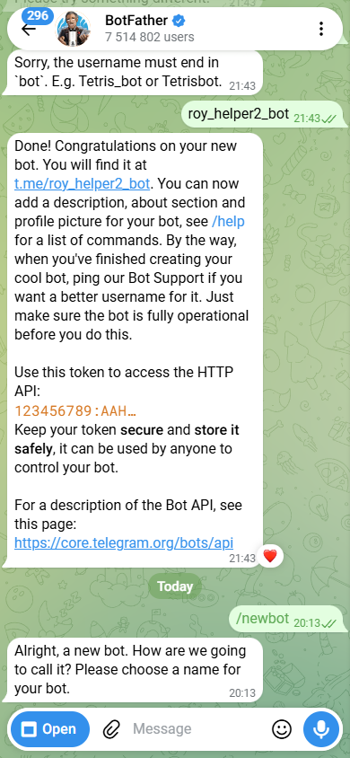
4. **השאלה הראשונה: השם שיופיע בשיחה.** BotFather כותב: *"Alright, a new bot. How are we going to call it? Please choose a name for your bot."* עונים בשם רגיל, בכל שפה ועם רווחים, למשל: `העוזר של דנה`.
5. **השאלה השנייה: שם המשתמש, כמו כתובת.** BotFather כותב: *"Good. Now let's choose a username for your bot. It must end in `bot`..."* כאן עונים **באנגלית, בלי רווחים, ובסוף המילה `bot`**, למשל: `dana_helper_bot`. השם הזה צריך להיות פנוי בכל טלגרם, אז אם כתוב שהוא תפוס, מוסיפים מספר: `dana_helper2_bot`. 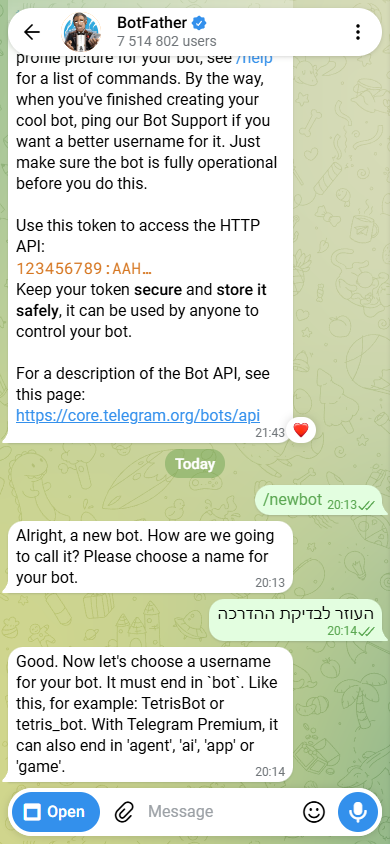
   - **לא ברור מה לכתוב?** שני השמות שונים: הראשון הוא מה שרואים בראש השיחה (אפשר בעברית). השני הוא הכתובת של הבוט, כמו `@dana_helper_bot`, ולכן רק אנגלית, בלי רווחים, ונגמר ב-`bot`.
6. BotFather שולח הודעה ארוכה שמתחילה ב-**Done!**. אחרי השורה *"Use this token to access the HTTP API:"* מופיעה שורה ארוכה של מספרים ואותיות, שנראית ככה: `123456789:AAH...`. זה הטוקן. (הצבע שלה תלוי בטלפון, ולפעמים היא בגופן אחר משאר ההודעה.) **לוחצים עליו פעם אחת**, והוא מועתק (מופיע "Copied"). לא הופיע "Copied"? לוחצים על ההודעה לחיצה ארוכה ובוחרים **Copy** (העתקה), ואז מוחקים בפתק את מה שמסביב לטוקן. 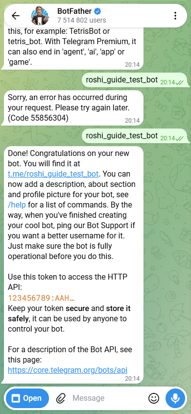
7. שומרים את הטוקן בצד, במנהל הסיסמאות של הטלפון, בפתק נעול, או בהודעה לעצמך ב-"הודעות שמורות" של טלגרם (בטלגרם: לוחצים על החיפוש למעלה וכותבים "Saved Messages" או "הודעות שמורות"). נצטרך אותו כשנעלה את הבוט לאוויר.
   <!-- wizard:telegram-check -->

> 🔒 **הטוקן הוא סיסמה.** מי שמחזיק אותו שולט בבוט. לא שולחים אותו לאף אחד ולא מדביקים אותו בצ'אט עם AI.

### איך יודעים שהצליח
יש לך טוקן שמתחיל במספרים, אחריהם נקודתיים, ואחריהם אותיות (`123456789:AAH...`).

<b>נתקעתי</b>

- **"Sorry, an error has occurred during your request"**: תקלה רגעית אצל טלגרם. מחכים חצי דקה ושולחים שוב את אותו שם משתמש.
- **"Sorry, this username is already taken"**: שם המשתמש תפוס. מוסיפים מספר או מילה, למשל `dana_helper2_bot`.
- **"Sorry, the username must end in 'bot'"**: שם המשתמש חייב להיגמר ב-`bot` (באותיות קטנות).
- **הטוקן דלף או שנשלח בטעות למישהו**: שולחים ל-BotFather `/revoke`, בוחרים את הבוט ומקבלים טוקן חדש.

לא הסתדר? [ספרו לנו איפה נתקעתם](https://github.com/roshilabs-hq/telegram-assistant/issues/new?template=stuck.yml), ונתקן את ההדרכה. אין לכם GitHub? [דרכים נוספות](support.md).

---

## שלב 2 מתוך 6 · מעלים את הבוט לאוויר
**⏱ כ-10 דקות**

**למה:** הבוט צריך מחשב שדולק 24 שעות ביממה. **Vercel** הוא המחשב באינטרנט שהבוט ירוץ עליו, ו-**Supabase** הוא המחברת שבה הבוט זוכר תזכורות, פתקים ורשימות. בשניהם יש מסלול חינמי שמספיק לבוט אישי. בשלב הזה פותחים את שניהם ומעלים את הבוט.

### מה עושים
> 🌐 **בשלב הזה נפתחים כמה אתרים באנגלית.** המסך אצלך שונה מהתמונה? לא מנחשים על מה ללחוץ. מחפשים את המילה המודגשת שכתובה בצעד. היא לא מופיעה? פותחים "נתקעתי" לפני שממשיכים.

1. לוחצים על הכפתור: [](https://vercel.com/new/clone?repository-url=https%3A%2F%2Fgithub.com%2Froshilabs-hq%2Ftelegram-assistant&project-name=telegram-assistant&repository-name=telegram-assistant&env=TELEGRAM_TOKEN%2CSETUP_PASSWORD&envDescription=BotFather%20token%20and%20a%20long%20setup%20password%20%2816%2B%20characters%2C%20best%20generated%20by%20a%20password%20manager%29&envLink=https%3A%2F%2Fgithub.com%2Froshilabs-hq%2Ftelegram-assistant%2Fblob%2Fmain%2Fdocs%2Fbrowser.md%23step-deploy&stores=%5B%7B%22type%22%3A%22integration%22%2C%22integrationSlug%22%3A%22supabase%22%2C%22productSlug%22%3A%22supabase%22%2C%22protocol%22%3A%22storage%22%7D%5D)
2. Vercel מבקש להתחבר. לוחצים **GitHub**. (GitHub הוא המקום שבו נשמר עותק של הקוד, שלך, בחינם.) 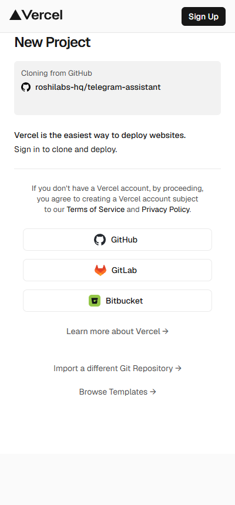
   - **יש לך GitHub:** מתחברים, ובחלון של GitHub לוחצים **Authorize**.
   - **אין לך GitHub:** בחלון של GitHub לוחצים **Create an account**. ממלאים מייל, סיסמה ושם משתמש באנגלית. אם מופיעה חידה ("Verify you are human"), פותרים אותה. מקלידים את הקוד שמגיע במייל, ובסוף לוחצים **Authorize**. ממשיכים רק כשמופיע המסך **New Project** של Vercel. לא חזרת אליו לבד? לוחצים שוב על כפתור ה-Deploy בהדרכה.
   - **יש לך כבר Vercel** (נכנסת בעבר עם מייל או Google): מתחברים כמו תמיד. בסעיף הבא מחברים אליו את GitHub.
   - אם אחרי ההתחברות מופיע **404**, זו תקלה של Vercel: חוזרים להדרכה ולוחצים שוב על הכפתור. ההתחברות כבר נשמרה.
   - **יש לך חשבון של עבודה** ב-Vercel או ב-GitHub: הבוט נוצר בחשבון שמחובר עכשיו. בודקים בפינה השמאלית העליונה של Vercel, ובשדה **Git Scope**, שמופיע השם **האישי** שלך ולא של העבודה. אם לא, מחליפים שם (לוחצים על השם ובוחרים את החשבון האישי), או מתחברים לחשבון האישי בחלון גלישה בסתר.
   - אם מופיע מסך **Secure Your Account with 2FA**: זו לא שגיאה. Vercel מציע אבטחה בשני שלבים, כלומר קוד נוסף בכל כניסה, וזה מומלץ. כדי לא להוסיף באמצע ההקמה עוד אפליקציה, אפשר ללחוץ למטה **Skip securing my account**, **ולהפעיל את זה מיד אחרי שהבוט עובד** (בהגדרות החשבון ב-Vercel ‹ **Authentication**). 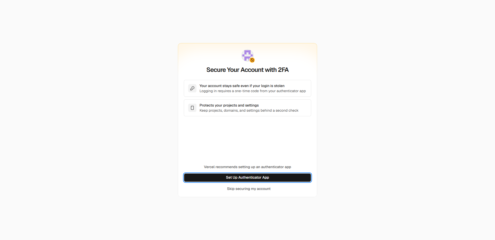
3. ב-**Git Scope** לוחצים **Add GitHub Scope**. נפתח חלון של GitHub: משאירים **All repositories**, גוללים למטה ולוחצים **Install**. זה נותן ל-Vercel גישה לקוד בחשבון ה-GitHub שלך. בחשבון חדש אין בו עדיין כלום חוץ מהבוט, וזה בטוח. **בחשבון קיים עם פרויקטים אחרים:** Vercel יוכל לקרוא גם אותם (הוא לא משנה אותם בלי שתחבר/י אותם אליו). מי שלא רוצה את זה פותח/ת חשבון GitHub חדש רק לבוט. (בחירה של חלק מהריפואים בלבד לא עובדת כאן: Vercel לא יוכל ליצור את עותק הקוד החדש.) 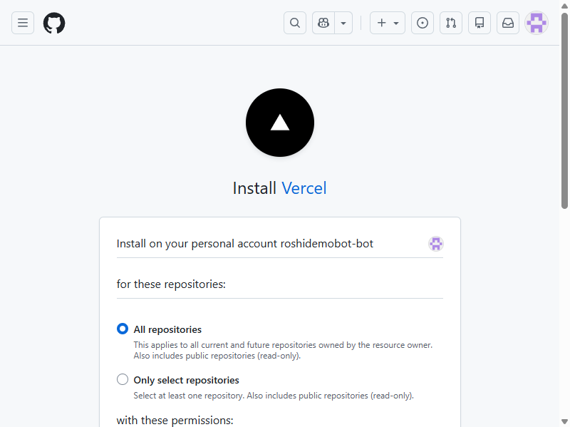
   - **במקום Git Scope מופיעים כפתורים GitHub / GitLab / Bitbucket** (קורה למי שכבר יש לו Vercel): לוחצים **GitHub**, ושם החשבון שלך מופיע לבד. ממשיכים לסעיף הבא. 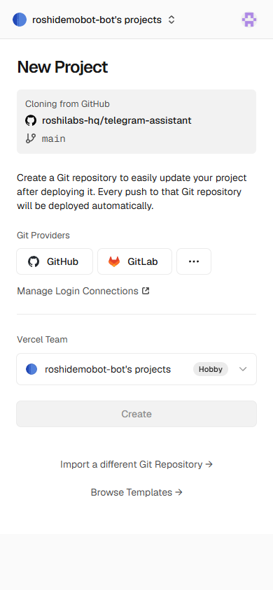
4. לוחצים **Create**. Vercel יוצר בחשבון שלך עותק פרטי של הקוד. 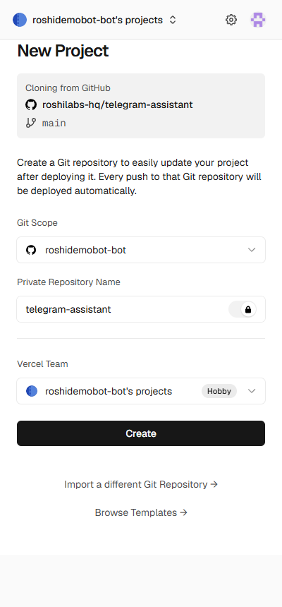
5. **Add Products ‹ Supabase**: לוחצים **Add** ‹ **Accept and Create**. 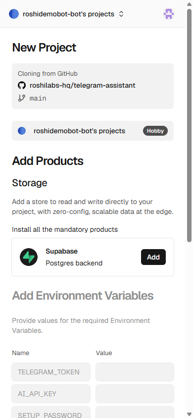
   - **יש לך כבר Supabase:** בכל זאת יוצרים כאן חדש **(מומלץ)**. הוא נפתח בלחיצה, בלי הרשמה, ולא נוגע בפרויקטים הקיימים שלך. אצל מי שכבר יצר Supabase דרך Vercel אין מסך **Accept and Create**, ועוברים ישר לבחירת האזור.
   - **שימו לב:** בחינם אפשר להחזיק **2 פרויקטים פעילים ב-Supabase לאדם**, גם כשהם נפתחים דרך Vercel, וכולל מה שכבר יש לך. זה הבוט השלישי? ראו "נתקעתי".
6. נפתח חלון באנגלית. הוא פותח את "המחברת" של הבוט, בחינם. ב-**Primary Region** בוחרים **Frankfurt, Germany** (ברירת המחדל היא Washington, צריך להחליף) (הכי קרוב לישראל). בשדה **Public Environment Variables Prefix** לא נוגעים. גוללים למטה ובודקים שמסומן **Supabase Free Plan**. **מופיע מחיר בדולרים לחודש (Pro, Team)? עוצרים ולא מאשרים**, וקוראים "נתקעתי". לוחצים **Continue** ‹ **Create**, מחכים כחצי דקה ללחצן **Done** ולוחצים עליו. 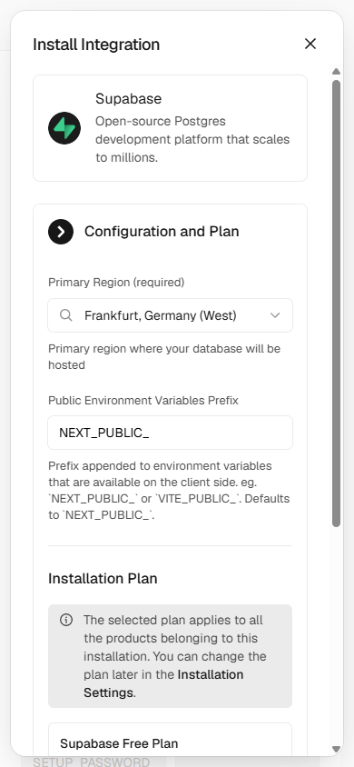
7. **Add Environment Variables**: יש שתי שורות. בכל שורה לוחצים על התיבה הריקה מימין (**Value**) וממלאים: 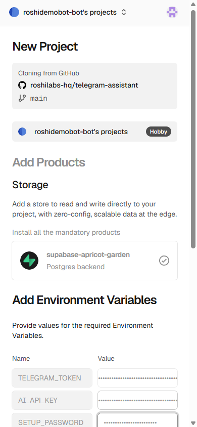
   - `TELEGRAM_TOKEN`: מדביקים (לחיצה ארוכה בתיבה ‹ **הדבק** / **Paste**) את הטוקן מ-BotFather, של הבוט **החדש** שיצרת בשלב הראשון. (מי שכבר יש לו בוט אחר: לא הטוקן שלו. כל בוט מחובר להתקנה אחת.)
   - `SETUP_PASSWORD`: ממציאים סיסמה חדשה, **16 תווים ומעלה**. היא המפתח לעמוד ההקמה, ומי שמנחש אותה יכול להשתלט על הבוט. באשף יש סיסמה מוכנה, עם כפתור העתקה. בלי האשף, הכי פשוט: ארבע מילים באנגלית ומספר, צמודים, למשל `BlueCatEatsPizza2026` (אבל לא בדיוק זו). לא סיסמה שכבר יש לך במקום אחר. **כותבים אותה בפתק** ליד הטוקן: עוד רגע נכנסים איתה.
   <!-- wizard:password -->
   - לא לוחצים **Deploy** לפני ששתי השורות מלאות. (את המפתח של Claude, "המוח", מוסיפים רק בסוף, בעמוד ההקמה. בינתיים לא צריך כרטיס אשראי.)
8. לוחצים **Deploy** ומחכים חצי דקה עד דקה, עד שמופיע **Congratulations!**. 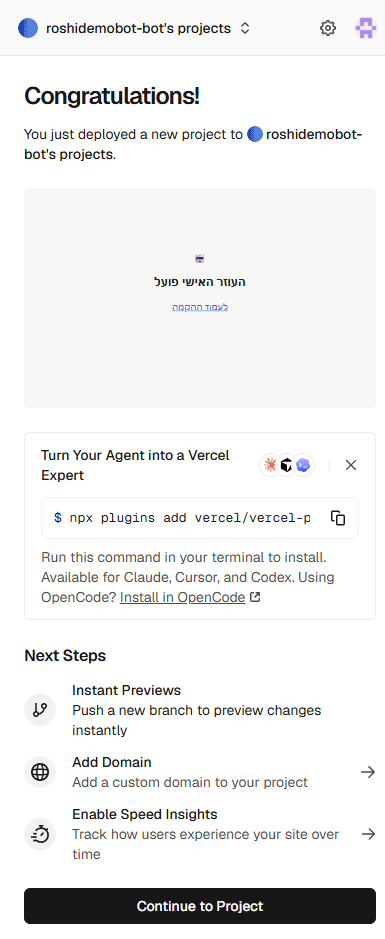
9. גוללים למטה (בטלפון הכפתור בתחתית) ולוחצים **Continue to Project**.
10. לוחצים **Visit**. נפתח עמוד "העוזר האישי פועל". לוחצים בו **לעמוד ההקמה**. 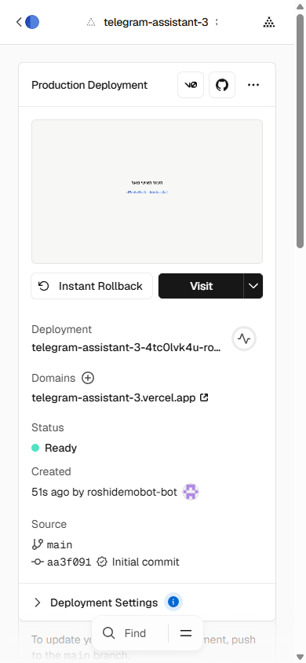
    - הכתובת של הבוט מופיעה תחת **Domains**, משהו כמו `telegram-assistant-xxxx.vercel.app`. (לא הכתובת הארוכה שתחת **Deployment**.)

### איך יודעים שהצליח
נכנסים לכתובת של הבוט ומוסיפים בסוף `/setup`, למשל `https://telegram-assistant-xxxx.vercel.app/setup`. מופיע עמוד בעברית שמבקש את סיסמת ההקמה. נכנסים, והשורה "מעלים את הבוט לאוויר" מסומנת ✅.

> כדי לחזור לפרויקט ב-Vercel בעתיד (למשל להוסיף מפתח): נכנסים ל-[vercel.com](https://vercel.com), מתחברים עם GitHub, ולוחצים על `telegram-assistant`.

<b>נתקעתי</b>

- **אחרי ההתחברות ל-Vercel מופיע 404**: לוחצים שוב על כפתור ה-Deploy בהדרכה. ההתחברות כבר נשמרה, והפעם הטופס ייפתח.
- **כתוב "A repository named telegram-assistant already exists"**: יש לך כבר עותק קוד (ריפו) בשם הזה ב-GitHub. בשדה **Private Repository Name** כותבים שם אחר, למשל `telegram-assistant-2` (ואם גם הוא תפוס, `telegram-assistant-3`), ולוחצים שוב **Create**. גם הכתובת של הבוט תהיה בשם הזה. 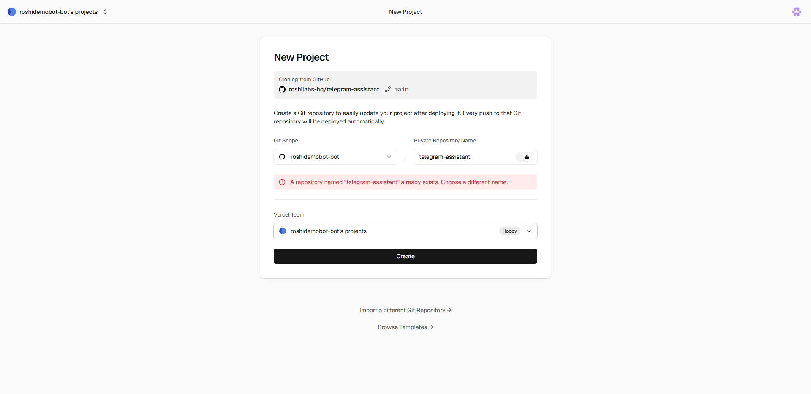
- **Vercel לא מצליח ליצור את הריפו, או כתוב שאין לו גישה**: בעבר נתת ל-Vercel גישה לחלק מעותקי הקוד שלך ב-GitHub, ולא לכולם. ב-GitHub ‹ **Settings** ‹ **Applications** ‹ **Vercel** ‹ **Configure** בוחרים **All repositories** ושומרים, ולוחצים שוב על כפתור ה-Deploy.
- **בחלון של Supabase כתוב "Upgrade your plan", ומופיעות רק תוכניות בתשלום (Pro, Team)**: כבר יש לך 2 פרויקטים חינמיים פעילים ב-Supabase. **לא בוחרים תוכנית בתשלום.** סוגרים את החלון, מפנים מקום, ולוחצים שוב **Add**: 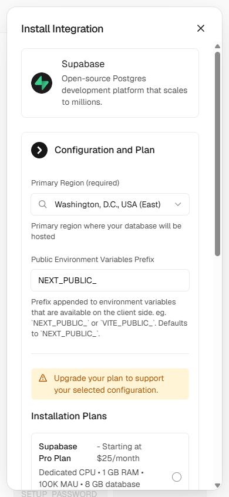
  - בוט ישן שלא צריך: מוחקים אותו לפי [איך מכבים הכול](turn-off.md), סעיף 3.
  - פרויקט אחר ב-[Supabase](https://supabase.com/dashboard) שלא בשימוש: נכנסים אליו ‹ **Pause project**. פרויקט מושהה לא נספר.
- **ב-Deploy כתוב "Build Failed"**: ההעלאה לא הושלמה, ושום דבר לא נמחק. לוחצים **Redeploy** אם הוא מופיע במסך. אם זה חוזר, **לא מוחקים את הפרויקט ולא פותחים חשבון חדש**. מצלמים את המסך ופונים אלינו.
- **לא הופיעה הצעה ליצור Supabase**: בדשבורד של הפרויקט ב-Vercel נכנסים ל-**Storage** ‹ **Create Database** ‹ **Supabase** ‹ **Frankfurt** ‹ **Connect**. אחר כך **Deployments** ‹ **Redeploy**.
- **בעמוד ההקמה כתוב "חסרים SUPABASE_URL..."**: Supabase לא חובר לפרויקט. עושים את מה שכתוב בסעיף הקודם.
- **שכחתי את סיסמת ההקמה**: ב-Vercel ‹ **Settings** ‹ **Environment Variables** משנים את `SETUP_PASSWORD`, ואז **Redeploy**. בעמוד ההקמה לוחצים שוב "הפעילו הכול".

לא הסתדר? [ספרו לנו איפה נתקעתם](https://github.com/roshilabs-hq/telegram-assistant/issues/new?template=stuck.yml), ונתקן את ההדרכה. אין לכם GitHub? [דרכים נוספות](support.md).

---

## שלב 3 מתוך 6 · לוחצים "הפעילו הכול"
**⏱ כ-2 דקות**

**למה:** הבוט עלה, אבל עוד לא מחובר לכלום. כפתור אחד עושה שלושה דברים: יוצר במסד את המקומות לתזכורות, לפתקים ולרשימות; מחבר את הבוט לטלגרם; ומפעיל שעון שבודק כל דקה אם הגיע זמן של תזכורת.

### מה עושים
1. נכנסים לעמוד ההקמה (בסוף השלב הקודם: **Visit** ‹ **לעמוד ההקמה**). **שומרים אותו במועדפים**: לכאן חוזרים לכל בדיקה או שינוי.
2. מקלידים את סיסמת ההקמה.
3. לוחצים **🚀 הפעילו הכול** ומחכים כמה שניות.
4. זה הכול. (בהתקנה מכפתור ה-Deploy, עם Supabase שנפתח בשלב הקודם, אין עוד פעולה.)

### איך יודעים שהצליח
בראש עמוד ההקמה כתוב "הבוט: @...". מוודאים שזה הבוט החדש שיצרת.

בעמוד ההקמה, תחת "לוחצים הפעילו הכול", שלוש שורות מסומנות ✅: הטבלאות קיימות, מחובר, רץ כל דקה. שורת התזמון יכולה לקחת עד שתי דקות (בבדיקה שלנו: דקה). מרעננים אם צריך.

שורה אחת לא ירוקה? לוחצים שוב **🚀 הפעילו הכול**, פעם אחת. עדיין לא? לא נכנסים להגדרות שלא מכירים. מצלמים את ההודעה (בלי סיסמאות או מפתחות) ופונים אלינו.

<b>נתקעתי</b>

- **מופיעה תיבה עם טקסט באנגלית וכפתור "העתקה"**: זה לא אמור לקרות בהתקנה מכפתור ה-Deploy (רק כש-Supabase לא חובר דרך Vercel). לא מעתיקים לבד. פונים אלינו, ונעשה את זה יחד.
- **"טלגרם לא מכיר את הטוקן"**: הטוקן הועתק לא שלם. מעתיקים מחדש מ-BotFather (`/mybots` ‹ הבוט ‹ **API Token**).
- **"התזמון לא רץ" גם אחרי כמה דקות**: לוחצים שוב **הפעילו הכול**. אם הופיעה תיבת העתקה, מריצים אותה שוב ב-Supabase.

לא הסתדר? [ספרו לנו איפה נתקעתם](https://github.com/roshilabs-hq/telegram-assistant/issues/new?template=stuck.yml), ונתקן את ההדרכה. אין לכם GitHub? [דרכים נוספות](support.md).

---

## שלב 4 מתוך 6 · מחברים את הבוט אליך
**⏱ כ-1 דקות**

**למה:** הבוט עונה רק לך. כדי לדעת מי זה "אתה", שולחים לו פעם אחת קוד סודי שמופיע בעמוד ההקמה. מי שאין לו את הקוד לא יקבל מהבוט תשובה בכלל.

### מה עושים
1. בעמוד ההקמה לוחצים **📲 פתיחת הבוט בטלגרם**. 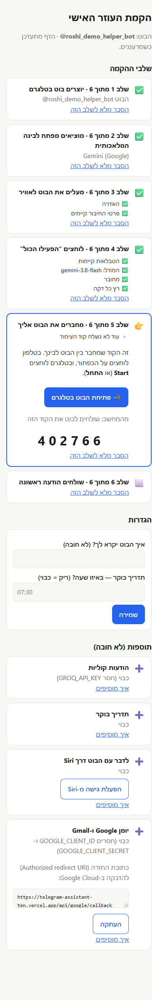
2. טלגרם נפתח בשיחה עם הבוט. לוחצים **Start** (או **התחל**). הקוד הסודי עובר לבד יחד עם הלחיצה, לא צריך להקליד אותו. 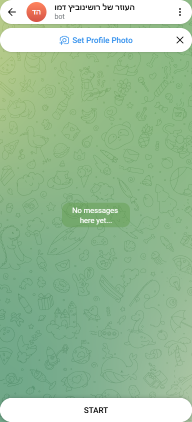
3. הבוט לא ענה "מחוברים!" תוך חצי דקה? חוזרים לעמוד ההקמה, ושולחים לבוט את שש הספרות שמופיעות שם, כהודעה רגילה.

> 💻 **עמוד ההקמה פתוח במחשב?** מחפשים בטלגרם את הבוט לפי שם המשתמש שלו (מופיע בראש עמוד ההקמה, למשל `@dana_helper_bot`), ושולחים לו את שש הספרות שבעמוד.

### איך יודעים שהצליח
הבוט עונה "🎉 מחוברים!", ובעמוד ההקמה השורה מסומנת ✅. במסלול הדפדפן הוא מוסיף "🧠 כמעט מוכן! חסר לי רק מוח". זה בסדר: זה השלב הבא.

🎉 **מצוין!** הבוט שלך כבר בטלגרם ומזהה אותך. נשאר רק לחבר לו את הבינה המלאכותית, כדי שיבין ויענה. זה השלב היחיד בהקמה שדורש תשלום מראש (5 דולר).

<b>נתקעתי</b>

- **הבוט לא עונה בכלל**: בודקים בעמוד ההקמה שהשלב "לוחצים הפעילו הכול" ירוק כולו. אם כן, לוחצים בעמוד ההקמה על **יצירת קוד צימוד** (אם מופיע) ומנסים שוב.
- **שלחתי מטלפון אחר בטעות**: בעמוד ההקמה, ב"אזור מתקדם", מנתקים וחוזרים על השלב.

לא הסתדר? [ספרו לנו איפה נתקעתם](https://github.com/roshilabs-hq/telegram-assistant/issues/new?template=stuck.yml), ונתקן את ההדרכה. אין לכם GitHub? [דרכים נוספות](support.md).

---

## שלב 5 מתוך 6 · מוסיפים לבוט מוח
**⏱ כ-10 דקות**

**למה:** הבוט כבר באוויר ומחובר אליך. חסר לו רק "מוח". הבוט "חושב" בעזרת Claude, הבינה המלאכותית של Anthropic. Claude מזהה את הבוט לפי **מפתח**: סיסמה ארוכה שמחוברת לחשבון שלך. **המפתח עובד רק כשיש בחשבון יתרה.** משלמים מראש: טוענים 5 דולר, וכל הודעה לבוט מורידה מהיתרה שבריר של אגורה עד כמה אגורות. לשימוש אישי זה בערך 2–5 דולר בחודש.

### מה עושים
> **כבר יש לך חשבון ב-Claude Console?** מתחברים, בודקים שיש יתרה, ויוצרים **מפתח חדש** לבוט. לא משתמשים במפתח של פרויקט אחר: כך אפשר יהיה למחוק או להחליף את המפתח של הבוט בלי לפגוע בשום דבר אחר.

> 💡 מנוי Claude Pro (באפליקציה או באתר) **לא** כולל מפתח. המפתח הוא חשבון נפרד, עם יתרה נפרדת.

1. נכנסים ל-[Claude Console](https://platform.claude.com) ולוחצים **Continue with Google** (או מקלידים מייל ולוחצים **Continue with email**, ואז מקלידים את הקוד שמגיע במייל). 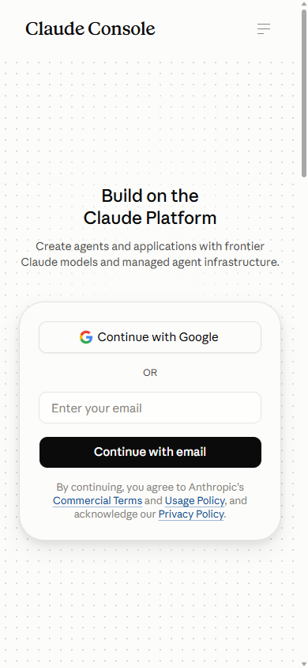
2. בחלון של Google בוחרים את החשבון שלך ולוחצים **המשך**.
3. **What's your full name?**: כותבים את השם שלך באנגלית, מסמנים את התיבה (גיל 18 ומעלה והסכמה לתנאים), ולוחצים **Continue**. 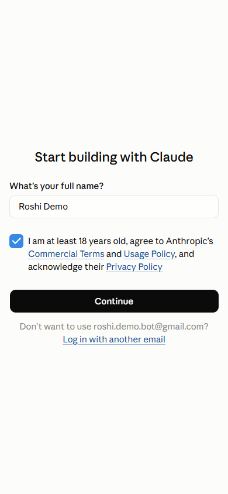
4. **How will you use the Claude API?**: לוחצים **Individual**. 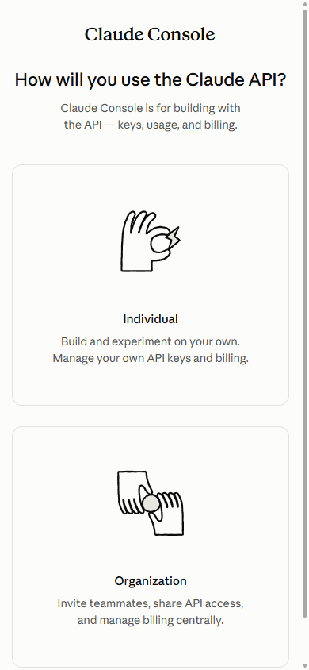
5. **Buy usage credits**: לוחצים **$5**. (מסומן מראש **$20**, צריך להחליף.) זו טעינה חד-פעמית של יתרה, **לא מנוי חודשי**. 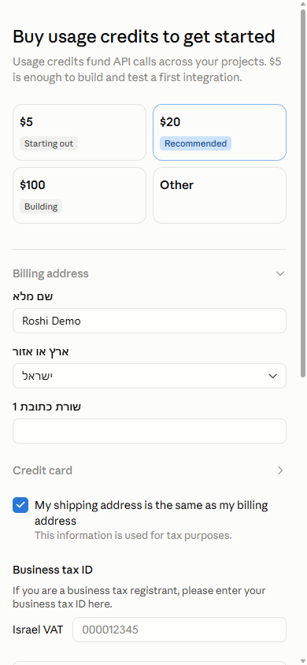
6. ממלאים את הכתובת ואת פרטי כרטיס האשראי. **השם והכתובת בדיוק כמו בכרטיס.** (האתר מבקש כתובת כי כך עובדים כל התשלומים בכרטיס באינטרנט, לא כי זה עסק.) יש שדה של מספר עסק או מע"מ (**Business tax ID**, **VAT**)? משאירים אותו ריק. בודקים שלמטה, ב-**Total due**, כתוב **$5.00**, ולוחצים **Buy credits**.
   - **התקרה:** ב-5 דולר אין טעינה אוטומטית (היא מופיעה רק כשבוחרים 20). ככה אין טעינה חוזרת אוטומטית: כשהיתרה נגמרת, הבוט אומר שנגמרה היתרה, ומחליטים בעצמך אם לטעון שוב.
   - **בודקים:** אחרי התשלום נכנסים ל-[Billing](https://platform.claude.com/settings/billing). צריך להופיע **$5.00** ו-**Auto-reload is off**. אם כתוב שהטעינה האוטומטית פעילה, מכבים אותה שם לפני שממשיכים. 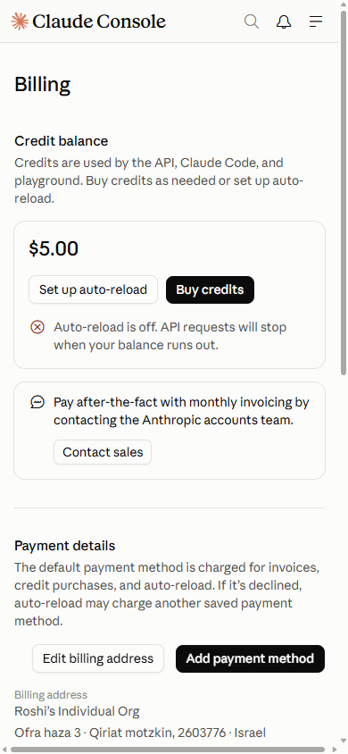
7. נכנסים ל-[API keys](https://platform.claude.com/settings/keys) ולוחצים **Create key**. 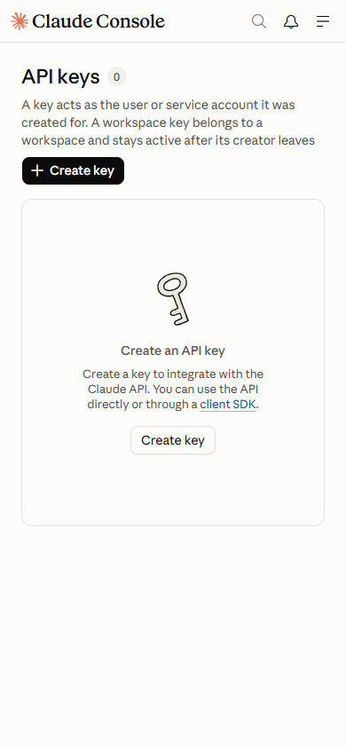
8. מופיע חלון על "identity federation". לא צריך אותו: לוחצים **Continue with an API key**. 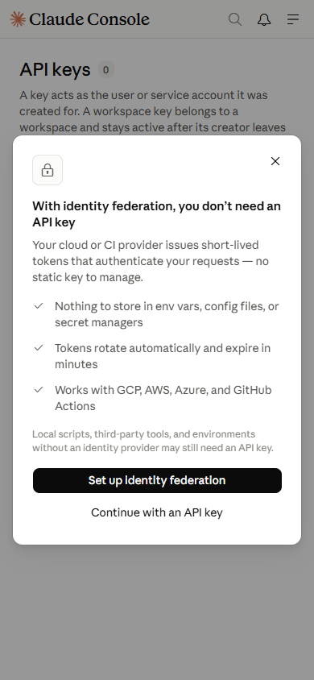
9. ב-**Name** כותבים `telegram-bot`. ב-**Expires** בוחרים **Never**. **חשוב:** ברירת המחדל היא 30 יום, ואחריהם הבוט מפסיק לענות. לוחצים **Create key**. 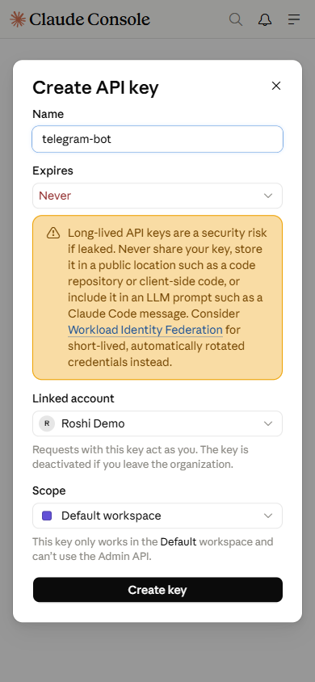
   - מופיעה אזהרה כתומה (**Long-lived API keys are a security risk**)? זה בסדר. היא אומרת שהמפתח יעבוד עד שתמחק/י אותו בעצמך, ולכן חשוב לא לשלוח אותו לאף אחד. בוחרים בזה כדי שהבוט לא ייעצר אחרי חודש. חושדים שמישהו ראה אותו? מוחקים אותו ויוצרים חדש (ב"נתקעתי").
10. לוחצים **Copy key**. המפתח מתחיל ב-`sk-ant-`, ו**הוא מוצג פעם אחת בלבד**. לוחצים **Done**. 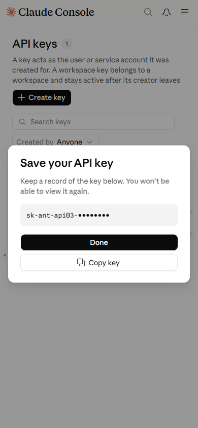

11. חוזרים לעמוד ההקמה (שמרת אותו במועדפים). בשלב **מוסיפים לבוט מוח** לוחצים בתיבה **המפתח של Claude**, מדביקים, ולוחצים **🧠 שמירה ובדיקה**. הבדיקה שולחת ל-Claude שאלה של מילה אחת, ולוקחת כמה שניות. 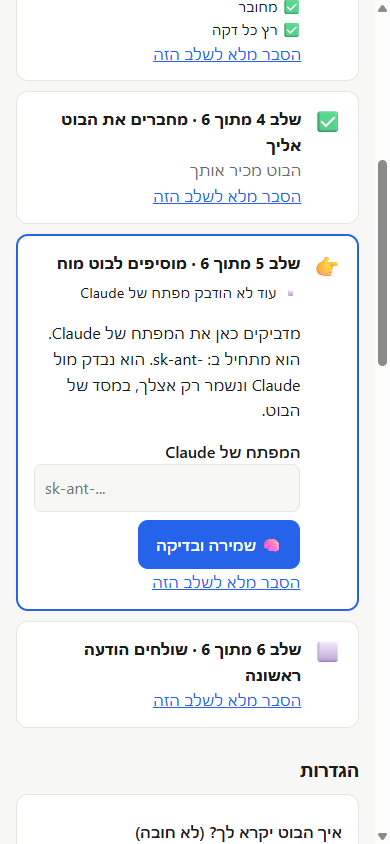

> 🔒 את פרטי כרטיס האשראי מזינים רק באתר של Anthropic. לא שולחים אותם לאף אחד, גם לא למי שעוזר לך בהתקנה.

### איך יודעים שהצליח
בעמוד ההקמה, בשלב "מוסיפים לבוט מוח", שתי שורות מסומנות ✅: **Claude (Anthropic)**, והמודל (`claude-haiku-...`). 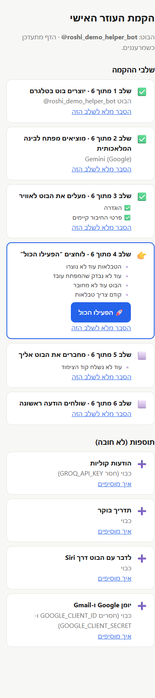

<b>נתקעתי</b>

- **"זה לא נראה כמו מפתח של Claude" או "הספק דחה את המפתח"**: המפתח הועתק לא שלם, או עם רווח. מעתיקים אותו שוב, כולו, ומדביקים שוב.
- **"אין בחשבון יתרה או אמצעי תשלום"**: ב-[Billing](https://platform.claude.com/settings/billing) טוענים יתרה (סעיפים 5–6), ומדביקים שוב.
- **הכרטיס נדחה ("Your card was declined")**: זה קורה גם לכרטיסים תקינים. לפי הסדר:
  1. בודקים שהשם והכתובת בטופס זהים לאלה שבכרטיס.
  2. בודקים באפליקציה של חברת האשראי אם מחכה עסקה לאישור, ומאשרים.
  3. מנסים כרטיס אחר. (בבדיקה שלנו כרטיס אחד נדחה שוב ושוב, וכרטיס אחר עבר מיד.)
  4. כרטיסי חיוב מיידי (דביט) נדחים לפעמים. כרטיס אשראי רגיל עובד.
- **ביקשו אימות בטלפון**: מקלידים את המספר שלך ואת הקוד שמגיע ב-SMS. זה חלק מההרשמה.
- **נסגר החלון לפני שהעתקתי את המפתח**: יוצרים מפתח חדש, ואת הישן מוחקים.
- **הבוט הפסיק לענות אחרי חודש**: כנראה המפתח פג (ברירת המחדל היא 30 יום). יוצרים מפתח חדש עם **Never**. בעמוד ההקמה, בתחתית (**אזור מתקדם**), מדביקים אותו בתיבה **החלפת המפתח של Claude** ‹ **החלפה ובדיקה**. (מי שהגדיר את המפתח ב-Vercel, למשל במסלול Claude Code: Settings ‹ Environment Variables ‹ `AI_API_KEY` ‹ Redeploy.)
- **המפתח דלף, או שלחת אותו בטעות למישהו**: ב-[API keys](https://platform.claude.com/settings/keys) מוחקים אותו (**Delete**), יוצרים חדש, ומדביקים בעמוד ההקמה בתיבה **החלפת המפתח של Claude**. המפתח הישן מפסיק לעבוד מיד.
- **הבוט כותב שנגמרה היתרה**: ב-[Billing](https://platform.claude.com/settings/billing) טוענים שוב.

לא הסתדר? [ספרו לנו איפה נתקעתם](https://github.com/roshilabs-hq/telegram-assistant/issues/new?template=stuck.yml), ונתקן את ההדרכה. אין לכם GitHub? [דרכים נוספות](support.md).

---

## שלב 6 מתוך 6 · שולחים הודעה ראשונה
**⏱ כ-1 דקות**

**למה:** לוודא שהכול עובד מקצה לקצה: הבוט מבין, זוכר ומזכיר.

### מה עושים
שולחים לבוט את שלוש ההודעות האלה, אחת אחרי השנייה:
1. `תזכיר לי בעוד 2 דקות לשתות מים`
2. `תוסיף חלב ולחם לרשימת הקניות`
3. `מה יש ברשימת הקניות?`

### איך יודעים שהצליח
הבוט מאשר כל בקשה 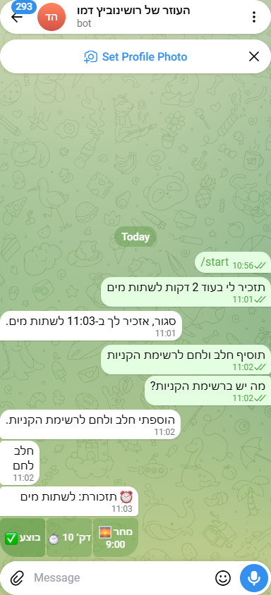, ואחרי שתי דקות מגיעה תזכורת עם שלושה כפתורים: ✅ בוצע, ⏱ 10 דק׳, 🌅 מחר 9:00. בראש עמוד ההקמה כתוב **🎉 הכול מוכן!** 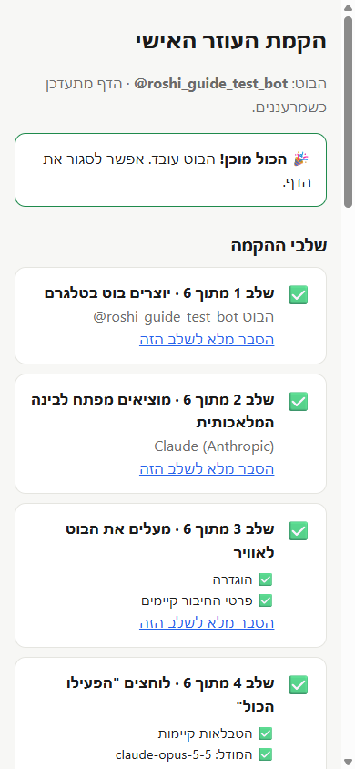 🎉 **סיימת!**

<b>נתקעתי</b>

- **הבוט עונה, אבל התזכורת לא הגיעה**: מחכים עוד דקה ומרעננים את עמוד ההקמה. "רץ כל דקה" ירוק? שולחים תזכורת חדשה לעוד 2 דקות ומחכים. לא ירוק? לוחצים **🚀 הפעילו הכול** (שלב "לוחצים הפעילו הכול"). אם גם התזכורת השנייה לא הגיעה, פונים אלינו.
- **הבוט עונה "ספק ה-AI עצר את הבקשה בגלל מכסה או יתרה"**: באתר של ספק ה-AI בודקים שאמצעי התשלום מחובר ושיש יתרה (השלב "מוסיפים לבוט מוח").
- **הבוט עונה "משהו נשבר אצלי"**: בעמוד ההקמה מחפשים איקס אדום. אם הכול ירוק, בודקים שיש יתרה אצל ספק ה-AI.
- **השעה של התזכורת לא נכונה**: הבוט מחשב לפי שעון ישראל. אם גרים באזור זמן אחר, מוסיפים ב-Vercel משתנה `TIMEZONE` (למשל `Europe/London`) ועושים Redeploy.

לא הסתדר? [ספרו לנו איפה נתקעתם](https://github.com/roshilabs-hq/telegram-assistant/issues/new?template=stuck.yml), ונתקן את ההדרכה. אין לכם GitHub? [דרכים נוספות](support.md).

---

# תוספות (לא חובה)

כל תוספת עומדת בפני עצמה. אפשר להוסיף אותה עכשיו או בעוד חודש.

## תוספת 1 מתוך 5 · הודעות קוליות
**⏱ כ-4 דקות**

**למה:** לדבר לבוט במקום להקליד: מקליטים הודעה קולית, והבוט מתמלל אותה ומבצע. מתאים במיוחד לנהיגה, או לסיכום אחרי פגישה ("תרשום ש... ותזכיר לי ביום שני ל...").

### מה עושים
1. נכנסים ל-[Groq Console](https://console.groq.com/keys). כותבים את המייל שלך ולוחצים **Continue with email**. 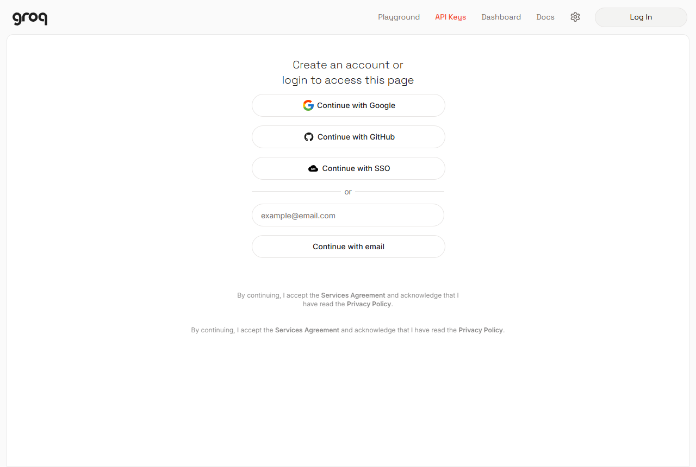
2. ב-Gmail מגיע מייל "Your login request to Groq". לוחצים בו **Log in**, והחשבון נפתח. זה חינם ובלי כרטיס אשראי: התוכנית החינמית נותנת עד 8 שעות של הודעות קוליות ביום, הרבה יותר ממה שבוט אישי צריך.
3. לוחצים **Create API Key**, בשם כותבים `telegram-bot` ולוחצים **Submit**. **מעתיקים מיד**: המפתח מתחיל ב-`gsk_` ומוצג רק פעם אחת.
4. ב-Vercel נכנסים לפרויקט ‹ **Settings** ‹ **Environment Variables** ‹ **Add Environment Variable**.
5. ב-**Key** כותבים `GROQ_API_KEY`, וב-**Value** מדביקים את המפתח. לוחצים **Save**.
6. **Deployments** ‹ שלוש נקודות ליד הפריסה העליונה ‹ **Redeploy**.

### איך יודעים שהצליח
בעמוד ההקמה, תחת "תוספות", השורה "הודעות קוליות" מסומנת ✅. שולחים לבוט הודעה קולית קצרה, והוא מבצע אותה.

<b>נתקעתי</b>

- **ב-Groq כתוב "does not belong to any organizations"**: זה קורה בכניסה עם **Continue with Google**. חוזרים לעמוד הכניסה, כותבים את המייל ולוחצים **Continue with email**.
- **לא הספקתי להעתיק את המפתח**: ב-**API Keys** מוחקים אותו ויוצרים חדש.
- **הבוט עונה "עוד לא חיברו אותי להודעות קוליות"**: שכחנו לעשות Redeploy אחרי ההוספה.
- **הבוט לא הבין מה אמרתי**: מדברים קרוב לטלפון. התמלול מכוון לעברית.

לא הסתדר? [ספרו לנו איפה נתקעתם](https://github.com/roshilabs-hq/telegram-assistant/issues/new?template=stuck.yml), ונתקן את ההדרכה. אין לכם GitHub? [דרכים נוספות](support.md).

---

## תוספת 2 מתוך 5 · תדריך בוקר
**⏱ כ-1 דקות**

**למה:** כל בוקר, בשעה שבוחרים, הבוט שולח סיכום: מה מחכה היום, ומה בהמשך השבוע.

### מה עושים
1. בעמוד ההקמה גוללים ל-**הגדרות**.
2. בשדה "תדריך בוקר — באיזו שעה?" כותבים שעה, למשל `07:30`.
3. לוחצים **שמירה**.

כדי לכבות, מוחקים את השעה ושומרים.

### איך יודעים שהצליח
בעמוד ההקמה, תחת "תוספות", השורה "תדריך בוקר" מסומנת ✅ עם השעה. בבוקר שלמחרת מגיעה הודעה שמתחילה ב-"☀️ בוקר טוב!".

<b>נתקעתי</b>

- **כתוב "שעת התדריך צריכה להיות בפורמט 07:30"**: שתי ספרות, נקודתיים, שתי ספרות. למשל `08:00`, ולא `8`.
- **התדריך לא הגיע**: בודקים בעמוד ההקמה שהשורה "רץ כל דקה" ירוקה.

לא הסתדר? [ספרו לנו איפה נתקעתם](https://github.com/roshilabs-hq/telegram-assistant/issues/new?template=stuck.yml), ונתקן את ההדרכה. אין לכם GitHub? [דרכים נוספות](support.md).

---

## תוספת 3 מתוך 5 · לדבר עם הבוט דרך Siri
**⏱ כ-6 דקות**

**למה:** "היי Siri, עוזר" — ואומרים מה צריך, בלי לפתוח את טלגרם. מתאים לאייפון. אותו בוט, אותו זיכרון.

זו התוספת הכי טכנית בערכה: בונים קיצור דרך באייפון עם כמה הגדרות באנגלית. אם זה מרגיש מסובך, אפשר לדלג. הבוט עובד מצוין גם בלי.

### מה עושים
1. בעמוד ההקמה, תחת "תוספות", לוחצים **הפעלת גישה מ-Siri**. מופיעות שתי שורות: כתובת ומפתח.
2. באייפון פותחים את אפליקציית **קיצורים** (Shortcuts) ולוחצים **+**.
3. מוסיפים פעולה **הכתבת טקסט** (Dictate Text).
4. מוסיפים פעולה **קבל תוכן של URL** (Get Contents of URL):
   - בכתובת מדביקים את השורה הראשונה מעמוד ההקמה.
   - **שיטה**: `POST`.
   - **כותרות**: מוסיפים `Authorization`, ובערך כותבים `Bearer ` (עם רווח) ומדביקים אחריו את השורה השנייה.
   - **גוף הבקשה**: JSON, עם שדה `text` שערכו הוא "טקסט מוכתב".
5. מוסיפים פעולה **הקרא טקסט** (Speak Text).
6. נותנים לקיצור שם קצר, למשל `עוזר`.

### איך יודעים שהצליח
אומרים "היי Siri, עוזר", ואחרי הצפצוף "מה יש לי מחר?". Siri מקריא את התשובה של הבוט.

<b>נתקעתי</b>

- **Siri אומר שיש שגיאה 401**: המפתח לא הודבק נכון. בודקים שכתוב `Bearer`, רווח, ואז המפתח, בלי רווחים נוספים.
- **Siri אומר שיש שגיאה 409**: הבוט עוד לא מחובר אליך. קודם עושים את השלב "מחברים את הבוט אליך".

לא הסתדר? [ספרו לנו איפה נתקעתם](https://github.com/roshilabs-hq/telegram-assistant/issues/new?template=stuck.yml), ונתקן את ההדרכה. אין לכם GitHub? [דרכים נוספות](support.md).

---

## תוספת 4 מתוך 5 · יומן Google ו-Gmail
**⏱ כ-15 דקות**

**למה:** הבוט יכול לקבוע פגישות ביומן ("קבע לי מחר ב-10 פגישה עם דני"), לענות "מה יש לי היום", לחפש ולקרוא מיילים, להכין טיוטות תשובה ולשלוח מיילים. כל שליחה, מחיקה וזימון של אנשים אחרים מחכים לאישור שלך: הבוט שולח הודעה עם הפרטים וכפתור "✅ לאשר", ושום דבר לא יוצא לפני שלוחצים. הגישה ניתנת דרך "אפליקציה" שפותחים אצלך ב-Google, ורק את/ה מחובר/ת אליה.

זה השלב הכי ארוך בערכה, כי Google דורש כמה אישורים. עוברים עליו פעם אחת, ולוקח כרבע שעה. **צריך מחשב**: האתר של Google Cloud כמעט לא שמיש בטלפון. אין מחשב? מדלגים על התוספת הזו. הבוט עובד מצוין גם בלעדיה, עם תזכורות, רשימות ופתקים.

כל המסכים של Google Cloud באנגלית. ההדרכה כותבת בדיוק על מה ללחוץ.

### מה עושים
**חלק א׳: פותחים פרויקט ב-Google Cloud (פעם אחת)**
1. נכנסים ל-[יצירת פרויקט ב-Google Cloud](https://console.cloud.google.com/projectcreate) עם אותו חשבון Google שהיומן שלו.
   - בכניסה הראשונה מופיע חלון **Welcome**: מסמנים את תיבת תנאי השימוש ולוחצים **Agree and continue**. 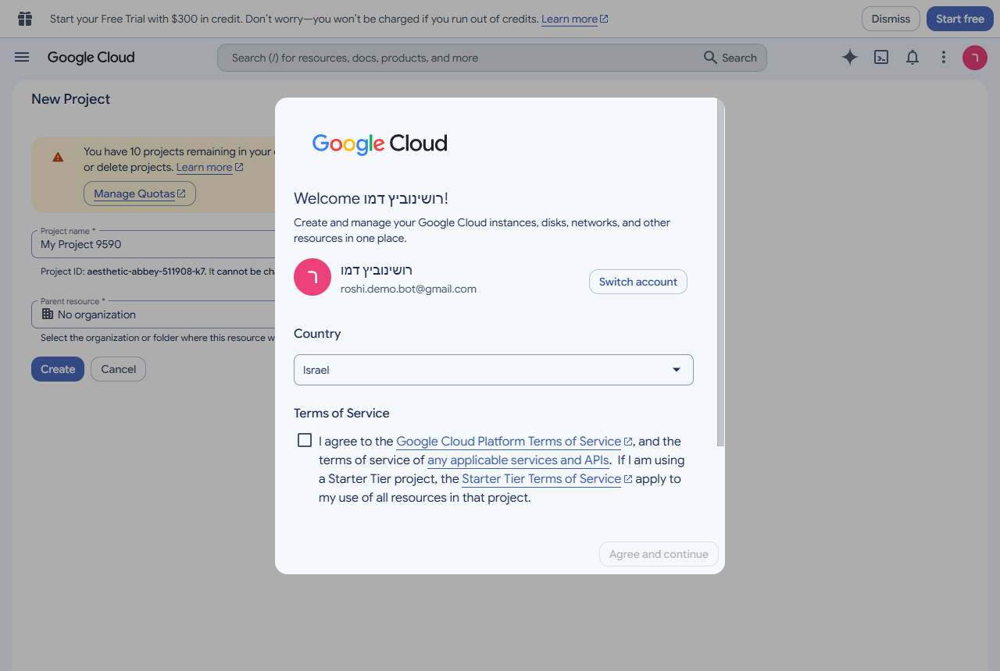
   - אם מופיע פס של ניסיון חינם (**Free Trial**), לוחצים **Dismiss**. לא צריך כרטיס אשראי.
2. ב-**Project name** כותבים `telegram-bot` ולוחצים **Create**. מחכים כמה שניות עד שהפרויקט נבחר (השם שלו מופיע למעלה). 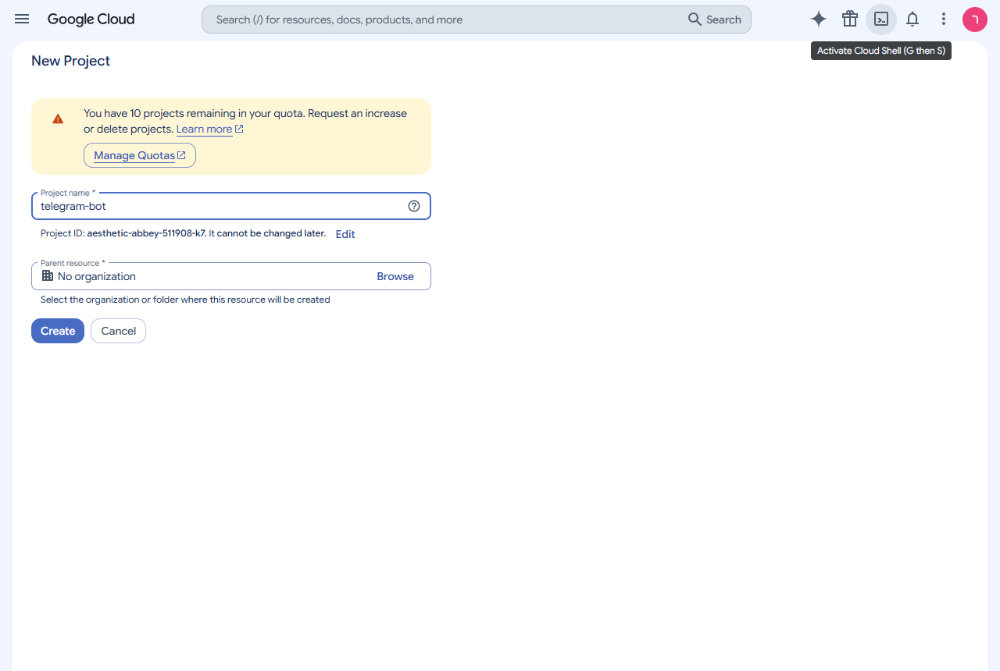
3. מפעילים את שני השירותים. בכל קישור לוחצים **Enable** ומחכים שהעמוד מתחלף: 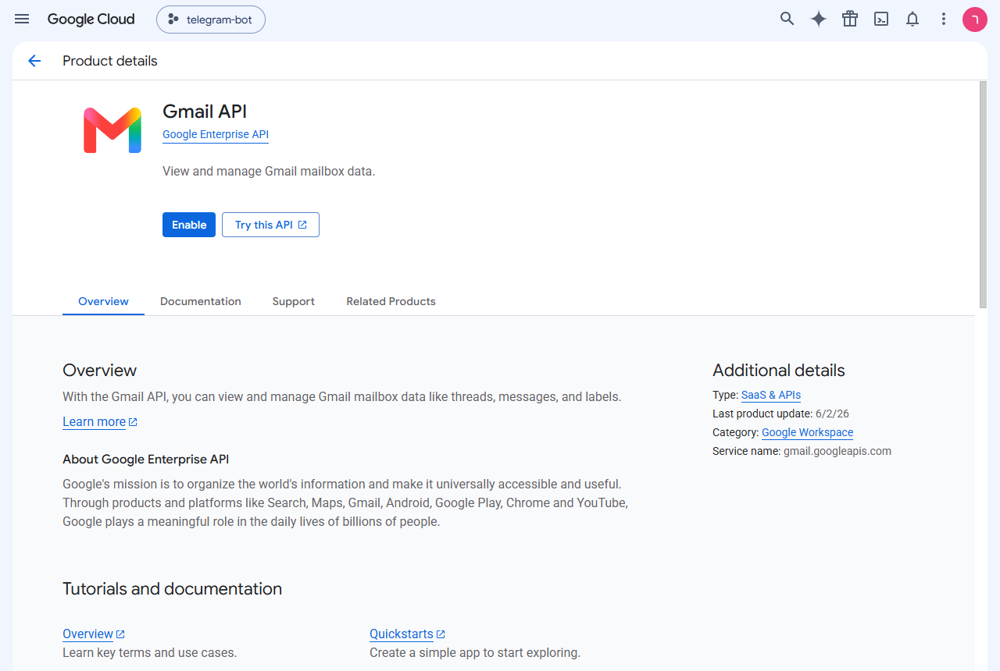
   - [Gmail API](https://console.cloud.google.com/apis/library/gmail.googleapis.com)
   - [Google Calendar API](https://console.cloud.google.com/apis/library/calendar-json.googleapis.com)

   אם בועה כחולה מכסה את הכפתור ("Click on the menu anytime..."), לוחצים בה **Got it**.

**חלק ב׳: מסך ההסכמה**
1. נכנסים ל-[Google Auth Platform](https://console.cloud.google.com/auth/overview) ולוחצים **Get started**. 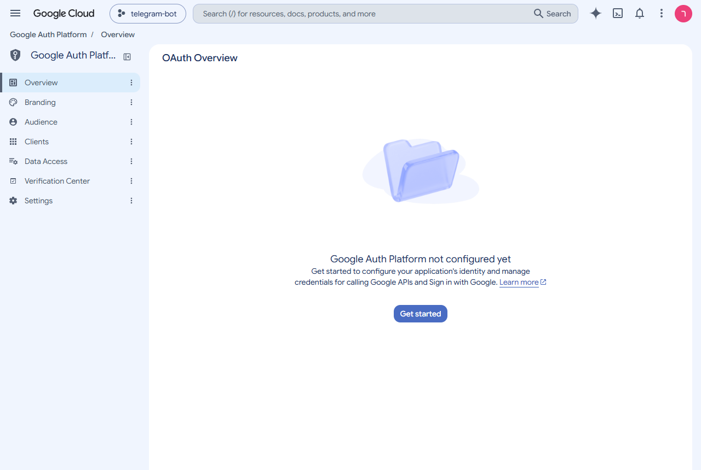
2. **App name**: `העוזר שלי`. **User support email**: בוחרים את המייל שלך מהרשימה. **Next**.
3. **Audience**: בוחרים **External**. **Next**.
4. **Contact Information**: כותבים את המייל שלך. **Next**.
5. **Finish**: מסמנים **I agree...** ולוחצים **Create**. 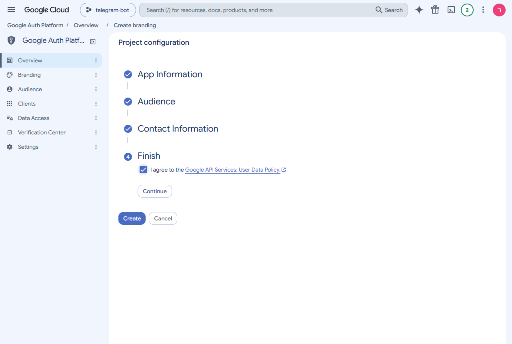

**חלק ג׳: מפתחות**
1. בתפריט משמאל נכנסים ל-**Clients** ‹ **Create client**.
2. **Application type**: בוחרים **Web application**. ב-**Name** כותבים `telegram-bot`.
3. תחת **Authorized redirect URIs** לוחצים **Add URI**, ומדביקים את **כתובת החזרה** מעמוד ההקמה. בתוספת "יומן Google ו-Gmail" יש לה כפתור **העתקה**. 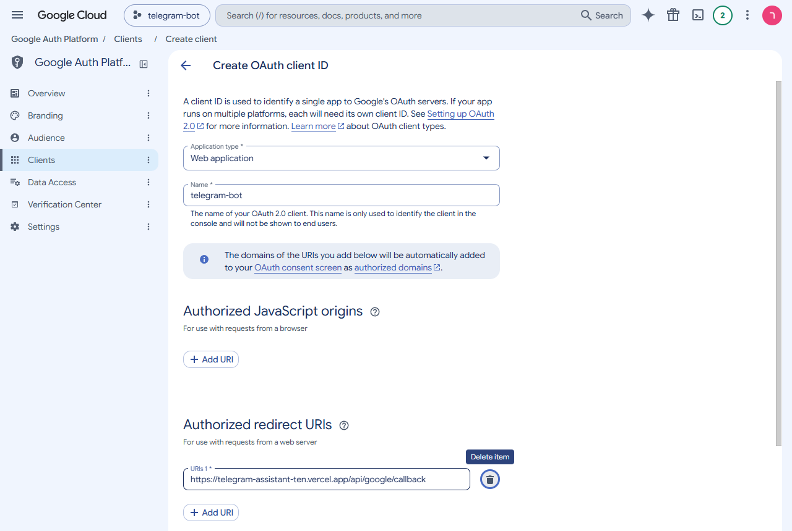
4. לוחצים **Create**. בחלון שנפתח מופיעים **Client ID** ו-**Client secret**, וליד כל אחד כפתור העתקה. **מעתיקים את שניהם עכשיו** למקום שמור (למשל פתק בטלפון). ה-secret מוצג רק פעם אחת: אחרי שסוגרים את החלון או מרעננים, אי אפשר להעתיק אותו שוב.

**חלק ד׳: מפרסמים את האפליקציה**
1. בתפריט נכנסים ל-**Branding**. ממלאים שני שדות, מתוך כפתורי ההעתקה בעמוד ההקמה: 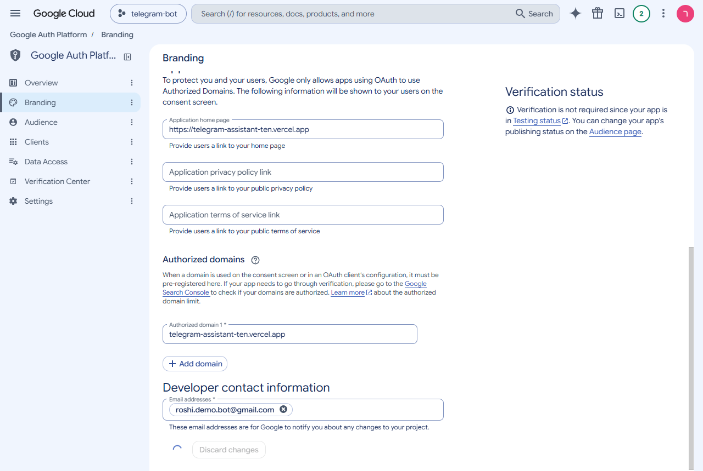
   - **Application home page**: הכתובת של הבוט.
   - **Application privacy policy link**: הכתובת של הבוט עם `/privacy` בסוף. הבוט כבר מציג שם מדיניות פרטיות.
   - תחת **Authorized domains** הכתובת של הבוט כבר מופיעה (Google הוסיף אותה בחלק ג׳). אם לא, לוחצים **Add domain** ומדביקים אותה בלי `https://` ובלי `/` בסוף.
2. לוחצים **Save** (בתחתית העמוד).
3. בתפריט נכנסים ל-**Audience** ולוחצים **Publish app** ‹ **Confirm**. 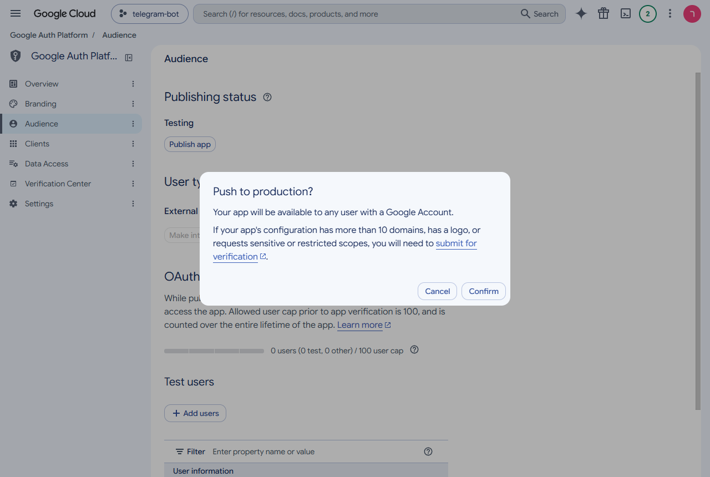 הסטטוס משתנה ל-**In production**.

> 💡 **למה Publish?** בלי זה, Google מנתק את החיבור כל 7 ימים. אחרי Publish האפליקציה נשארת שלך ופרטית: אף אחד לא יכול להשתמש בה בלי הסיסמה שלו, ו-Google לא צריך לאשר אותה בשביל שימוש אישי. בלי לוגו, ולכן גם בלי בדיקה של Google.

**חלק ה׳: מכניסים את המפתחות לבוט**

1. ב-Vercel ‹ הפרויקט ‹ **Settings** ‹ **Environment Variables** מוסיפים שני משתנים:
   - `GOOGLE_CLIENT_ID`: ה-Client ID.
   - `GOOGLE_CLIENT_SECRET`: ה-Client secret.
2. **Deployments** ‹ שלוש נקודות ליד הפריסה העליונה ‹ **Redeploy**, ומחכים שיסתיים.
> ⚠️ **לפני שלוחצים, כדאי לדעת:** עוד רגע Google יציג אזהרה אדומה ש"לא אימתה את האפליקציה". זה צפוי: Google מציג אותה לכל אפליקציה אישית שלא עברה בדיקה עסקית, והאפליקציה היא זו שיצרת עכשיו בחלקים א׳–ד׳. **לפני שממשיכים בודקים** שהכתובת שמופיעה באזהרה היא הכתובת של הבוט שלך (אותה כתובת של עמוד ההקמה). כתובת אחרת? לא ממשיכים, וחוזרים למצב בטוח.

3. בעמוד ההקמה מרעננים, ובתוספת "יומן Google ו-Gmail" לוחצים **🔗 חיבור לחשבון Google**.
4. בוחרים את החשבון. 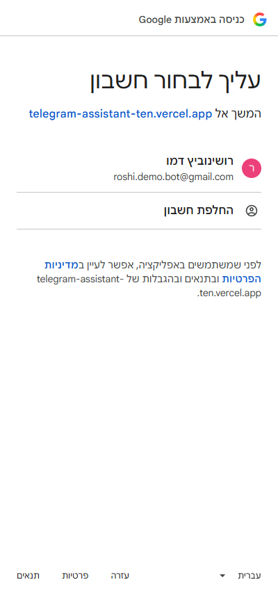
5. מופיע מסך אזהרה **"Google לא אימתה את האפליקציה הזו"**. זה צפוי: זו האפליקציה שלך, ו-Google מציג את האזהרה לכל אפליקציה אישית. לוחצים **מתקדם**, ואז למטה **כניסה אל telegram-assistant-xxxx.vercel.app (לא מאובטח)**. (באנגלית: **Advanced** ‹ **Go to ... (unsafe)**.) 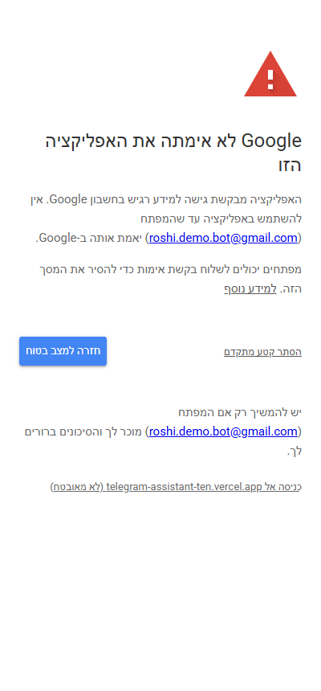
6. במסך **"כניסה אל ..."** לוחצים **המשך**. 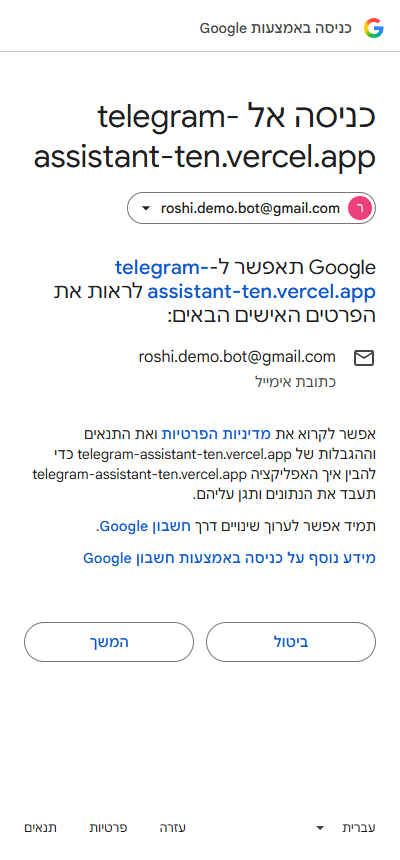
7. **מסמנים "בחירת הכול"** (יומן ומייל) ולוחצים **המשך**. 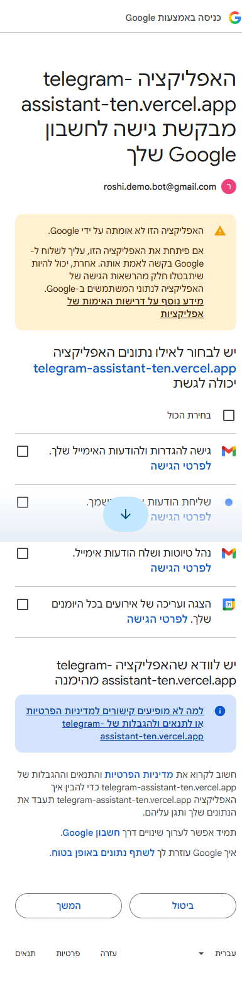

> 💡 במסכים האלה Google מציג את הכתובת של הבוט, ולא את השם "העוזר שלי". זה תקין.

### איך יודעים שהצליח
מופיע עמוד "✅ יומן ו-Gmail מחוברים" עם המייל שלך 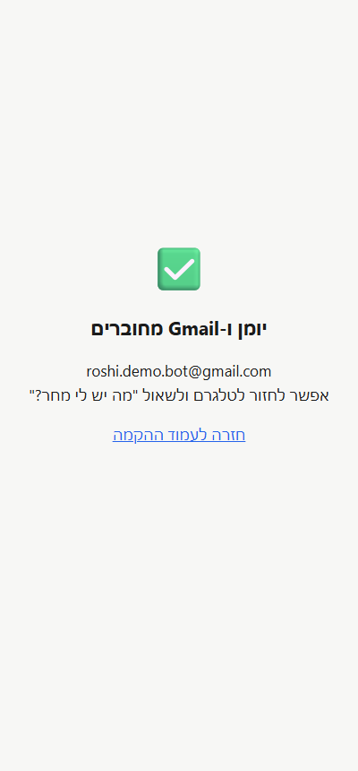, ובעמוד ההקמה התוספת מסומנת ✅. שולחים לבוט "קבע לי מחר ב-10 פגישה עם דני", ואחר כך "מה יש לי מחר?". הבוט עונה עם הפגישה מהיומן. כשמבקשים למחוק, מגיעה הודעה עם כפתור "✅ לאשר", והאירוע נמחק רק אחרי הלחיצה.

<b>נתקעתי</b>

- **הכפתור Publish app אפור, וכתוב "complete your configuration on the Branding page"**: ב-**Branding** חסרים דף הבית או מדיניות הפרטיות (חלק ד׳, סעיף 1), או שלא לחצת **Save**.
- **ב-Branding כתוב "Missing domain"**: לוחצים **Add domain** ומדביקים את הכתובת של הבוט בלי `https://`.
- **"Error 400: redirect_uri_mismatch"**: הכתובת ב-Google Cloud לא זהה בדיוק לזו שבעמוד ההקמה. ב-**Clients** פותחים את הלקוח, מוחקים את הכתובת ומדביקים שוב מכפתור ההעתקה. אחרי השמירה מחכים חמש דקות.
- **"Access blocked: ... has not completed the Google verification process"**: האפליקציה עוד במצב בדיקה. ב-**Audience** לוחצים **Publish app**.
- **"Gmail API has not been used in project..."**: שכחנו להפעיל את אחד השירותים בחלק א׳ (סעיף 3).
- **איבדתי את ה-Client secret**: Google כבר לא מציג אותו שוב. ב-**Clients** פותחים את הלקוח ולוחצים **Add secret**, מעתיקים את החדש, ואת הישן מכבים (**Disable**) ומוחקים.
- **הבוט אומר שהחיבור ל-Google פג**: בעמוד ההקמה, בתוספת "יומן Google ו-Gmail", לוחצים **🔗 חיבור מחדש**. זה קורה אם שינית סיסמה ב-Google או הסרת את הגישה.
- **לא סימנתי את כל התיבות**: לוחצים שוב על החיבור בעמוד ההקמה ומסמנים הכול.

לא הסתדר? [ספרו לנו איפה נתקעתם](https://github.com/roshilabs-hq/telegram-assistant/issues/new?template=stuck.yml), ונתקן את ההדרכה. אין לכם GitHub? [דרכים נוספות](support.md).

---

## תוספת 5 מתוך 5 · עדכונים אוטומטיים
**⏱ כ-2 דקות**

**למה:** כשמשהו בערכה משתפר או מתוקן, הבוט שלך יכול לקבל את זה. פעם בשבוע GitHub בודק אם יצאה גרסה חדשה, ואם כן, פותח לך **בקשת עדכון**. שום דבר לא משתנה בבוט עד שאת/ה מאשר/ת בלחיצה.

לא חובה. מפעילים רק אחרי שהבוט כבר עובד. בבקשת עדכון שכתוב בה **This branch has conflicts**, לא מאשרים (ראו "נתקעתי").

### מה עושים
**חלק א׳: הגדרה חד-פעמית**
1. בעמוד ההקמה, בתוספת "עדכונים אוטומטיים", לוחצים **1. הוספת קובץ העדכונים ל-GitHub**. נפתח ב-GitHub קובץ חדש, עם השם והתוכן כבר מוכנים. (Vercel לא מעתיק את הקובץ הזה כשהוא יוצר את עותק הקוד, ולכן מוסיפים אותו פעם אחת.) 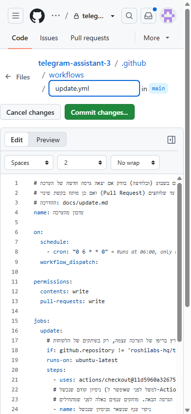
2. לוחצים **Commit changes...**, ובחלון שנפתח שוב **Commit changes**. חוזרים לעמוד ההקמה.
   - כתוב "A file with the same name already exists"? הקובץ כבר קיים. ממשיכים לסעיף הבא.
3. לוחצים **2. ההגדרה ב-GitHub**. (אפשר גם ידנית: ב-GitHub נכנסים לריפו `telegram-assistant` שלך ‹ **Settings** ‹ **Actions** ‹ **General**.)
4. גוללים למטה עד **Workflow permissions**.
5. מסמנים את התיבה **Allow GitHub Actions to create and approve pull requests**. 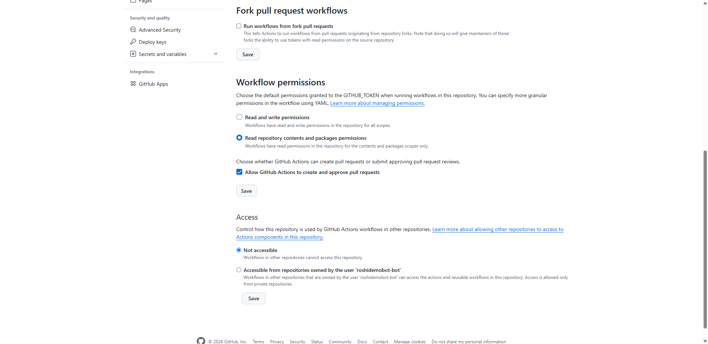
6. לוחצים **Save** שמתחת לתיבה.

**חלק ב׳: כשמגיע עדכון**
1. GitHub שולח מייל "🔄 עדכון לבוט מהערכה", ובעמוד ההקמה מופיע **יש גרסה חדשה**. לוחצים על הקישור במייל, או בעמוד ההקמה על **🔄 לבקשת העדכון ב-GitHub**.
2. בעמוד הבקשה גוללים למטה ולוחצים **Merge pull request**. 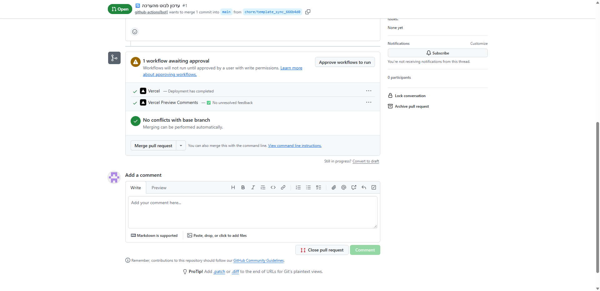
3. לוחצים **Confirm merge**. (אם יש חץ ליד הכפתור, בוחרים **Create a merge commit** ולא Squash.)
4. מחכים דקה או שתיים ומרעננים את עמוד ההקמה. בתחתית כתוב מספר הגרסה החדשה. אם משהו לא ירוק, לוחצים **🚀 הפעילו הכול**. (כשהכול ירוק הכפתור לא מופיע, ואין צורך בו.)

### איך יודעים שהצליח
בתחתית עמוד ההקמה כתוב מספר הגרסה, ובתוספת "עדכונים אוטומטיים" כתוב **מעודכן**. הבוט ממשיך לענות כרגיל, וכל התזכורות, הפתקים והרשימות נשארים.

<b>נתקעתי</b>

- **לא מגיעה בקשת עדכון, למרות שבעמוד ההקמה כתוב שיש גרסה חדשה**: הבדיקה רצה פעם בשבוע, ביום ראשון בבוקר. כדי לא לחכות: ב-GitHub ‹ **Actions** ‹ **עדכון מהערכה** ‹ **Run workflow** ‹ **Run workflow**.
- **ב-Actions יש איקס אדום ליד "עדכון מהערכה"**: כנראה לא סימנת את התיבה בחלק א׳ (או לא לחצת **Save**). מסמנים ומריצים שוב כמו בסעיף הקודם.
- **בבקשת העדכון כתוב "This branch has conflicts"**: שינית בעבר את הקוד של הבוט (למשל עם Claude Code), והעדכון נוגע באותו מקום. במסלול Claude Code כותבים ל-Claude: "תמזג את בקשת העדכון מהערכה". במסלול הדפדפן אפשר לסגור את הבקשה (**Close pull request**) ולהמשיך עם הגרסה הנוכחית.
- **אחרי ה-Merge הבוט לא עונה**: בעמוד ההקמה לוחצים **🚀 הפעילו הכול** ובודקים מה אדום.

לא הסתדר? [ספרו לנו איפה נתקעתם](https://github.com/roshilabs-hq/telegram-assistant/issues/new?template=stuck.yml), ונתקן את ההדרכה. אין לכם GitHub? [דרכים נוספות](support.md).

---

