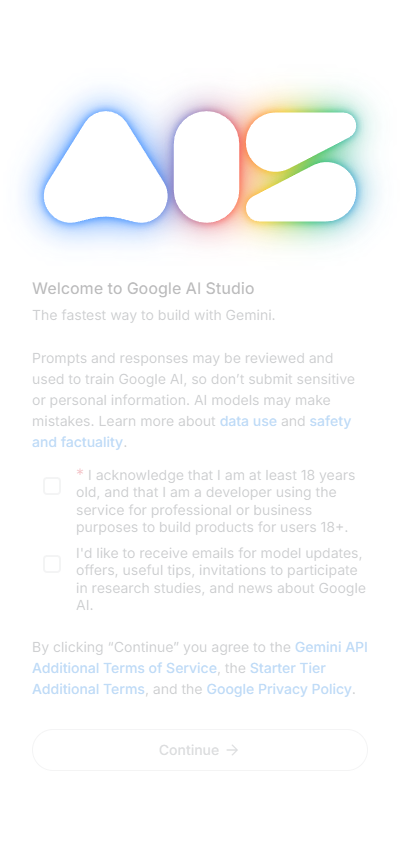
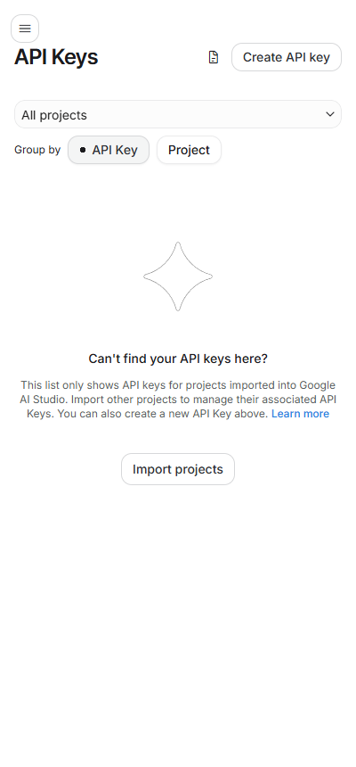
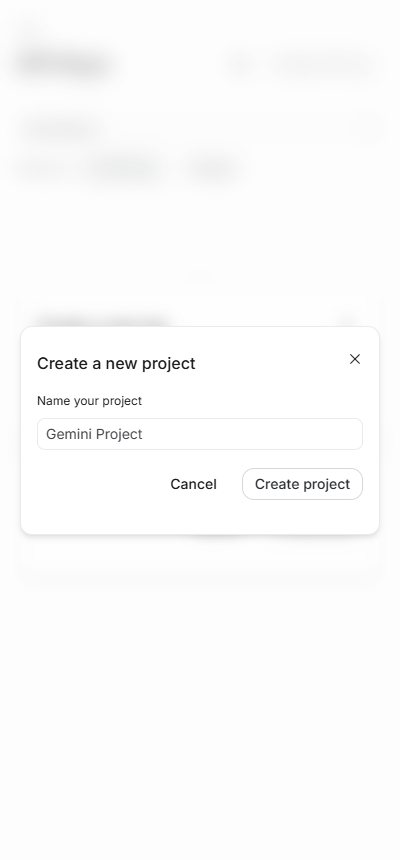
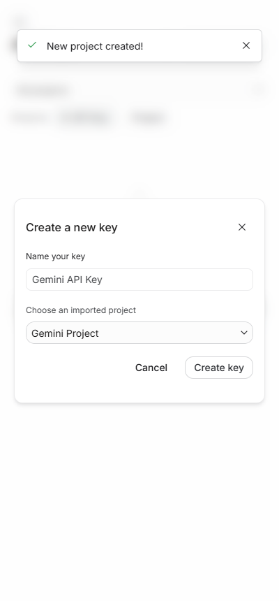

<!-- נוצר אוטומטית מתוך steps/ ו-addons/ — לא לערוך ידנית. להרצה: npm run guide -->

# מסלול ב׳: עם Claude Code

7 שלבים · בערך 37 דקות בסך הכול. אפשר לעצור באמצע ולחזור בכל רגע.

**לפני שמתחילים:** [מה צריך](choose-path.md#requirements).

| # | שלב | זמן |
|---|---|---|
| 1 | [מורידים את הקוד ופותחים ב-Claude Code](#step-get-code) | כ-10 דק׳ |
| 2 | [יוצרים בוט בטלגרם](#step-create-bot) | כ-3 דק׳ |
| 3 | [מוציאים מפתח לבינה המלאכותית](#step-ai-key) | כ-10 דק׳ |
| 4 | [מעלים את הבוט לאוויר](#step-deploy) | כ-10 דק׳ |
| 5 | [לוחצים "הפעילו הכול"](#step-activate) | כ-2 דק׳ |
| 6 | [מחברים את הבוט אליך](#step-pair) | כ-1 דק׳ |
| 7 | [שולחים הודעה ראשונה](#step-say-hello) | כ-1 דק׳ |

---

## שלב 1 מתוך 7 · מורידים את הקוד ופותחים ב-Claude Code
**⏱ כ-10 דקות**

**למה:** במסלול הזה Claude עובד איתך על עותק של הקוד שיושב אצלך במחשב. הוא מסביר כל שלב, עושה בעצמו את מה שאפשר, ויכול גם לשנות את הבוט לפי בקשה.

### מה עושים
1. מוודאים שמותקנים: [Node.js](https://nodejs.org) (גרסת LTS), [Git](https://git-scm.com/downloads), [VS Code](https://code.visualstudio.com) והתוסף **Claude Code** ב-VS Code. צריך גם מנוי Claude (Pro ומעלה).
2. מתחברים ל-[GitHub](https://github.com). **אין לך חשבון?** לוחצים [**Sign up**](https://github.com/signup), ממלאים מייל, סיסמה ושם משתמש באנגלית, ומקלידים את הקוד שמגיע במייל. **יש לך?** מתחברים כרגיל.
3. נכנסים ל-[הריפו של הערכה](https://github.com/roshilabs-hq/telegram-assistant), לוחצים **Use this template** ‹ **Create a new repository**, נותנים שם, בוחרים **Private**, ולוחצים **Create**.
4. בריפו החדש לוחצים **Code** ומעתיקים את הכתובת.
5. ב-VS Code: **File** ‹ **Clone Repository** (או F1 ← `Git: Clone`), מדביקים את הכתובת ובוחרים תיקייה.
6. כשהתיקייה נפתחת, פותחים את Claude Code (סמל ה-Claude בצד) וכותבים `/start`.

### איך יודעים שהצליח
Claude עונה בעברית ומתחיל להוביל אותך בשלב הבא.

<b>נתקעתי</b>

- **`/start` לא מוכר**: התיקייה שנפתחה ב-VS Code היא לא תיקיית הריפו עצמה. פותחים בדיוק את התיקייה שיש בה `README.md` ו-`package.json` (**File** ‹ **Open Folder**).
- **אין כפתור Use this template**: צריך להיות מחוברים ל-GitHub.

---

## שלב 2 מתוך 7 · יוצרים בוט בטלגרם
**⏱ כ-3 דקות**

**למה:** כל בוט בטלגרם נולד אצל "אבא של הבוטים", BotFather. הוא נותן לבוט שם, וגם **טוקן**: סיסמה ארוכה שבעזרתה הקוד שלנו מדבר בשם הבוט.

### מה עושים
> **אין לך טלגרם?** מתקינים את האפליקציה מ-[telegram.org](https://telegram.org) ונרשמים עם מספר הטלפון. **כבר יצרת בעבר בוטים?** אין בעיה, יוצרים עוד אחד: לכל בוט יש טוקן משלו, והישנים ממשיכים לעבוד.

1. פותחים את טלגרם (בטלפון או במחשב) ונכנסים ל-[@BotFather](https://t.me/BotFather). ליד השם צריך להופיע וי כחול.
2. לוחצים **Start** (או **התחל**).
3. שולחים לו `/newbot`.
4. הוא שואל איך לקרוא לבוט. כותבים שם שיופיע בשיחה, למשל `העוזר של דנה`.
5. הוא שואל על **שם משתמש** לבוט. כותבים שם באנגלית שנגמר ב-`bot`, למשל `dana_helper_bot`. אם השם תפוס, מנסים שם אחר.
6. BotFather שולח הודעה ארוכה, ובאמצע שלה שורה שנראית ככה: `123456789:AAH...`. זה הטוקן. לוחצים עליו כדי להעתיק.
7. שומרים את הטוקן בצד, למשל בהודעה לעצמך ב-"הודעות שמורות" בטלגרם. נצטרך אותו כשנעלה את הבוט לאוויר.

> 🔒 **הטוקן הוא סיסמה.** מי שמחזיק אותו שולט בבוט. לא שולחים אותו לאף אחד ולא מדביקים אותו בצ'אט עם AI.

### איך יודעים שהצליח
יש לך טוקן שמתחיל במספרים, אחריהם נקודתיים, ואחריהם אותיות (`123456789:AAH...`).

<b>נתקעתי</b>

- **"Sorry, this username is already taken"**: שם המשתמש תפוס. מוסיפים מספר או מילה, למשל `dana_helper2_bot`.
- **"Sorry, the username must end in 'bot'"**: שם המשתמש חייב להיגמר ב-`bot` (באותיות קטנות).
- **הטוקן דלף או שנשלח בטעות למישהו**: שולחים ל-BotFather `/revoke`, בוחרים את הבוט ומקבלים טוקן חדש.

---

## שלב 3 מתוך 7 · מוציאים מפתח לבינה המלאכותית
**⏱ כ-10 דקות**

**למה:** הבוט "חושב" בעזרת שירות בינה מלאכותית. השירות מזהה אותנו לפי **מפתח**: סיסמה ארוכה שמחוברת לחשבון שלך אצל הספק. **המפתח חייב להיות מחובר לאמצעי תשלום.** משלמים לפי שימוש: כל הודעה לבוט עולה שבריר של אגורה עד כמה אגורות, ובסוף החודש מקבלים חשבון על מה שהשתמשת בפועל. בלי אמצעי תשלום הבוט לא יעבוד.

### מה עושים
בוחרים ספק אחד. אם לא בטוחים, בוחרים Gemini: הוא הזול מבין השלושה, ותמיד אפשר להחליף אחר כך.

> **כבר יש לך חשבון אצל אחד הספקים?** מתחברים אליו, בודקים שאמצעי התשלום מחובר, ויוצרים **מפתח חדש** לבוט. לא משתמשים במפתח של פרויקט אחר: כך אפשר יהיה למחוק או להחליף את המפתח של הבוט בלי לפגוע בשום דבר אחר.

| ספק | עלות משוערת לשימוש אישי | איך משלמים | פרטיות |
|---|---|---|---|
| **Gemini של Google (מומלץ)** | בערך 2–5 דולר בחודש | כרטיס אשראי בחשבון Google, חיוב בסוף החודש | השיחות לא משמשות לאימון כשהחיוב פעיל |
| **ChatGPT של OpenAI** | בערך 2–5 דולר בחודש | טעינה מראש בכרטיס אשראי (מינימום 5 דולר) | השיחות לא משמשות לאימון |
| **Claude של Anthropic** | בערך 15–30 דולר בחודש (המודל החזק ביותר) | טעינה מראש בכרטיס אשראי (מינימום 5 דולר) | השיחות לא משמשות לאימון |

> 💡 "שימוש אישי" כאן הוא כ-10–20 הודעות ביום. מי ששולח הרבה יותר משלם יותר. כדאי להגדיר תקרת הוצאה (מוסבר בכל ספק למטה), ואז אין הפתעות.

> 🔒 את פרטי כרטיס האשראי מזינים רק באתר של הספק. לא שולחים אותם לאף אחד, גם לא למי שעוזר לך בהתקנה.

**Gemini (מומלץ):**
1. נכנסים ל-[Google AI Studio](https://aistudio.google.com/apikey) עם חשבון Google.
2. בפעם הראשונה מופיע מסך ברוכים הבאים. מסמנים את התיבה הראשונה (גיל 18 ומעלה) ולוחצים **Continue**. 
3. לוחצים **Create API key**. 
4. אם בשדה **Project** כתוב "No Cloud Projects Available", לוחצים עליו ‹ **Create project** ‹ **Create project**. 
5. לוחצים **Create key**. 
6. ליד המפתח לוחצים על סמל ההעתקה. המפתח מתחיל ב-`AQ.` (או ב-`AIza` במפתחות ישנים).
7. **מחברים אמצעי תשלום:** באותה שורה של המפתח לוחצים **Set up billing**, ובחלון של Google ממלאים את פרטי כרטיס האשראי ומאשרים. בסוף, בעמוד המפתחות ליד הפרויקט כתוב **Paid** (או Tier 1) במקום **Free**.
8. **תקרת הוצאה (מומלץ):** ב-[Billing ‹ Budgets & alerts](https://console.cloud.google.com/billing/budgets) לוחצים **Create budget**, וקובעים למשל 10 דולר. Google ישלח מייל כשמתקרבים לסכום.

**ChatGPT:**
1. נכנסים ל-[OpenAI Platform](https://platform.openai.com/api-keys) ונרשמים.
2. ב-[Billing](https://platform.openai.com/settings/organization/billing) לוחצים **Add payment details**, מזינים כרטיס אשראי וטוענים 5 דולר.
3. **תקרת הוצאה (מומלץ):** ב-[Limits](https://platform.openai.com/settings/organization/limits) קובעים תקרה חודשית, למשל 10 דולר.
4. לוחצים **Create new secret key**, ומעתיקים. המפתח מתחיל ב-`sk-`.

**Claude:**
1. נכנסים ל-[Anthropic Console](https://console.anthropic.com/settings/keys) ונרשמים.
2. ב-[Billing](https://console.anthropic.com/settings/billing) מזינים כרטיס אשראי וטוענים 5 דולר.
3. **תקרת הוצאה (מומלץ):** ב-[Limits](https://console.anthropic.com/settings/limits) קובעים תקרה חודשית.
4. ב-**API Keys** לוחצים **Create Key**, ומעתיקים. המפתח מתחיל ב-`sk-ant-`.

שומרים את המפתח בצד, ליד הטוקן מהשלב הקודם.

> 💡 מנוי ChatGPT Plus או Claude Pro **לא** כולל מפתח. המפתח הוא חשבון נפרד אצל אותו ספק, עם חיוב נפרד.

### איך יודעים שהצליח
יש לך מפתח שמתחיל ב-`AQ.` או `AIza` (Gemini), ב-`sk-ant-` (Claude) או ב-`sk-` (ChatGPT), ואמצעי התשלום מחובר. בדיקה אמיתית שהמפתח עובד תקרה בעמוד ההקמה, בשלב "לוחצים הפעילו הכול".

<b>נתקעתי</b>

- **ב-Google כתוב שהשירות לא זמין במדינה שלך**: עוברים ל-ChatGPT או ל-Claude.
- **לא מוצאים את Set up billing ב-AI Studio**: בתפריט משמאל נכנסים ל-**Billing**, ומשם מחברים כרטיס.
- **הכרטיס נדחה**: חלק מכרטיסי החיוב המיידי (דביט) לא מתקבלים. מנסים כרטיס אשראי רגיל.
- **לא מוצאים איפה להעתיק את המפתח אחרי שנסגר החלון**: יוצרים מפתח חדש. את הישן אפשר למחוק.
- **לא בטוחים איזה ספק לבחור**: Gemini. ההחלפה אחר כך היא החלפה של שדה אחד.

---

## שלב 4 מתוך 7 · מעלים את הבוט לאוויר
**⏱ כ-10 דקות**

**למה:** הבוט צריך מחשב שדולק 24 שעות ביממה. **Vercel** הוא המחשב באינטרנט שהבוט ירוץ עליו, ו-**Supabase** הוא המחברת שבה הבוט זוכר תזכורות, פתקים ורשימות. בשניהם יש מסלול חינמי שמספיק לבוט אישי. בשלב הזה פותחים את שניהם ומעלים את הבוט.

### מה עושים
1. כותבים ל-Claude: "תעלה את הבוט לאוויר". Claude פותח לך את [vercel.com/new](https://vercel.com/new).
2. מתחברים עם GitHub (מי שאין לו חשבון Vercel, נפתח לו אחד בדרך). ברשימה בוחרים את הריפו שיצרת בשלב "מורידים את הקוד" ולוחצים **Import**.
3. תחת **Environment Variables** מוסיפים שלושה שדות: `TELEGRAM_TOKEN`, `AI_API_KEY`, `SETUP_PASSWORD`. את הערכים מעתיקים מהקובץ `.env.local` ש-Claude פתח לך. Claude לא רואה אותם.
4. לוחצים **Deploy** ומחכים לסיום.
5. בדשבורד של הפרויקט: **Storage** ‹ **Create Database** ‹ **Supabase** ‹ **Frankfurt** ‹ **Create**. גם מי שכבר יש לו Supabase יוצר כאן חדש **(מומלץ)**, בגלל המגבלה של 2 פרויקטים חינמיים בחשבון.
6. **Deployments** ‹ שלוש נקודות ליד הפריסה העליונה ‹ **Redeploy**, כדי שהבוט יכיר את Supabase.
7. מעתיקים ל-Claude את הכתובת שמופיעה תחת **Domains**.

> בווינדוס עם שם משתמש בעברית, הפקודה `vercel` בטרמינל קורסת. לכן הפריסה עוברת דרך האתר של Vercel.

### איך יודעים שהצליח
נכנסים לכתובת של הבוט ומוסיפים בסוף `/setup`, למשל `https://telegram-assistant-xxxx.vercel.app/setup`. מופיע עמוד בעברית שמבקש את סיסמת ההקמה. נכנסים, והשורה "מעלים את הבוט לאוויר" מסומנת ✅.

> כדי לחזור לפרויקט ב-Vercel בעתיד (למשל להוסיף מפתח): נכנסים ל-[vercel.com](https://vercel.com), מתחברים עם GitHub, ולוחצים על `telegram-assistant`.

<b>נתקעתי</b>

- **אחרי ההתחברות ל-Vercel מופיע 404**: לוחצים שוב על כפתור ה-Deploy בהדרכה. ההתחברות כבר נשמרה, והפעם הטופס ייפתח.
- **כתוב שהריפו `telegram-assistant` כבר קיים**: יש לך כבר עותק קוד (ריפו) בשם הזה ב-GitHub. בשדה **Repository Name** כותבים שם אחר, למשל `telegram-assistant-2`.
- **Vercel לא מצליח ליצור את הריפו, או כתוב שאין לו גישה**: בעבר נתת ל-Vercel גישה לחלק מעותקי הקוד שלך ב-GitHub, ולא לכולם. ב-GitHub ‹ **Settings** ‹ **Applications** ‹ **Vercel** ‹ **Configure** בוחרים **All repositories** ושומרים, ולוחצים שוב על כפתור ה-Deploy.
- **ב-Supabase כתוב שהגעת למגבלת הפרויקטים**: בחרת ארגון Supabase קיים. בוחרים במקום זה ליצור חדש, כמו בסעיף 5.
- **ב-Deploy כתוב "Build Failed"**: לוחצים **Redeploy**. אם זה חוזר, מצלמים את המסך ופונים אלינו.
- **לא הופיעה הצעה ליצור Supabase**: בדשבורד של הפרויקט ב-Vercel נכנסים ל-**Storage** ‹ **Create Database** ‹ **Supabase** ‹ **Frankfurt** ‹ **Connect**. אחר כך **Deployments** ‹ **Redeploy**.
- **בעמוד ההקמה כתוב "חסרים SUPABASE_URL..."**: Supabase לא חובר לפרויקט. עושים את מה שכתוב בסעיף הקודם.
- **שכחתי את סיסמת ההקמה**: ב-Vercel ‹ **Settings** ‹ **Environment Variables** משנים את `SETUP_PASSWORD`, ואז **Redeploy**. בעמוד ההקמה לוחצים שוב "הפעילו הכול".

---

## שלב 5 מתוך 7 · לוחצים "הפעילו הכול"
**⏱ כ-2 דקות**

**למה:** הבוט עלה, אבל עוד לא מחובר לכלום. כפתור אחד עושה ארבעה דברים: יוצר במסד את המקומות לתזכורות, לפתקים ולרשימות; בודק שמפתח ה-AI עובד ובוחר מודל; מחבר את הבוט לטלגרם; ומפעיל שעון שבודק כל דקה אם הגיע זמן של תזכורת.

### מה עושים
1. נכנסים לעמוד ההקמה: הכתובת של הבוט + `/setup`. **שומרים אותו במועדפים**: לכאן חוזרים לכל בדיקה או שינוי.
2. מקלידים את סיסמת ההקמה.
3. לוחצים **🚀 הפעילו הכול** ומחכים כמה שניות. 
4. ברוב המקרים זה הכול. אם בכל זאת מופיעה תיבה עם טקסט באנגלית וכפתור **העתקה**, יש עוד פעולה אחת שהבוט לא יכול לעשות לבד. הטקסט הזה יוצר את "המחברת" של הבוט במסד שלך ומפעיל את התזמון, ולא נוגע בשום דבר אחר:
   1. לוחצים **העתקה**.
   2. לוחצים על הקישור "עורך ה-SQL של Supabase" (נפתח בלשונית חדשה).
   3. מדביקים בחלון הגדול ולוחצים **Run** (למטה מימין). צריך להופיע **Success**.
   4. חוזרים לעמוד ההקמה ומרעננים.

### איך יודעים שהצליח
בעמוד ההקמה, תחת "לוחצים הפעילו הכול", ארבע שורות מסומנות ✅: הטבלאות קיימות, המודל, מחובר, רץ כל דקה. שורת התזמון יכולה לקחת עד שתי דקות. מרעננים אם צריך.

<b>נתקעתי</b>

- **"הספק דחה את המפתח"**: המפתח הועתק לא שלם, או עם רווח. מעתיקים אותו שוב ומחליפים ב-Vercel ‹ **Settings** ‹ **Environment Variables** ‹ `AI_API_KEY`, ואז **Redeploy**.
- **"נגמרה המכסה או שאין יתרה"**: ב-Claude או ב-ChatGPT צריך לטעון יתרה. ב-Gemini לחבר אמצעי תשלום (בשלב "מוציאים מפתח לבינה המלאכותית", סעיף 7).
- **"טלגרם לא מכיר את הטוקן"**: הטוקן הועתק לא שלם. מעתיקים מחדש מ-BotFather (`/mybots` ‹ הבוט ‹ **API Token**).
- **"התזמון לא רץ" גם אחרי כמה דקות**: לוחצים שוב **הפעילו הכול**. אם הופיעה תיבת העתקה, מריצים אותה שוב ב-Supabase.

---

## שלב 6 מתוך 7 · מחברים את הבוט אליך
**⏱ כ-1 דקות**

**למה:** הבוט עונה רק לך. כדי לדעת מי זה "אתה", שולחים לו פעם אחת קוד סודי שמופיע בעמוד ההקמה. מי שאין לו את הקוד לא יקבל מהבוט תשובה בכלל.

### מה עושים
**מהטלפון:**
1. בעמוד ההקמה לוחצים **📲 פתיחת הבוט בטלגרם**. 
2. טלגרם נפתח בשיחה עם הבוט. לוחצים **Start** (או **התחל**). 

**מהמחשב:**
1. מחפשים בטלגרם את הבוט לפי שם המשתמש שלו (מופיע בראש עמוד ההקמה, למשל `@dana_helper_bot`).
2. שולחים לו את שש הספרות שמופיעות בעמוד ההקמה.

### איך יודעים שהצליח
הבוט עונה "🎉 מחוברים!" עם כמה דוגמאות, ובעמוד ההקמה השורה מסומנת ✅.

<b>נתקעתי</b>

- **הבוט לא עונה בכלל**: בודקים בעמוד ההקמה שהשלב "לוחצים הפעילו הכול" ירוק כולו. אם כן, לוחצים בעמוד ההקמה על **יצירת קוד צימוד** (אם מופיע) ומנסים שוב.
- **שלחתי מטלפון אחר בטעות**: בעמוד ההקמה, ב"אזור מתקדם", מנתקים וחוזרים על השלב.

---

## שלב 7 מתוך 7 · שולחים הודעה ראשונה
**⏱ כ-1 דקות**

**למה:** לוודא שהכול עובד מקצה לקצה: הבוט מבין, זוכר ומזכיר.

### מה עושים
שולחים לבוט את שלוש ההודעות האלה, אחת אחרי השנייה:
1. `תזכיר לי בעוד 2 דקות לשתות מים`
2. `תוסיף חלב ולחם לרשימת הקניות`
3. `מה יש ברשימת הקניות?`

### איך יודעים שהצליח
הבוט מאשר כל בקשה , ואחרי שתי דקות מגיעה תזכורת עם שלושה כפתורים: ✅ בוצע, ⏱ 10 דק׳, 🌅 מחר 9:00. 🎉 **סיימת!**

<b>נתקעתי</b>

- **הבוט עונה, אבל התזכורת לא הגיעה**: בעמוד ההקמה בודקים שהשורה "רץ כל דקה" ירוקה.
- **הבוט עונה "ספק ה-AI עצר את הבקשה בגלל מכסה או יתרה"**: באתר של ספק ה-AI בודקים שאמצעי התשלום מחובר ושיש יתרה (השלב "מוציאים מפתח לבינה המלאכותית").
- **הבוט עונה "משהו נשבר אצלי"**: בעמוד ההקמה מחפשים איקס אדום. אם הכול ירוק, בודקים שיש יתרה אצל ספק ה-AI.
- **השעה של התזכורת לא נכונה**: הבוט מחשב לפי שעון ישראל. אם גרים באזור זמן אחר, מוסיפים ב-Vercel משתנה `TIMEZONE` (למשל `Europe/London`) ועושים Redeploy.

---

# תוספות (לא חובה)

כל תוספת עומדת בפני עצמה. אפשר להוסיף אותה עכשיו או בעוד חודש.

## תוספת 1 מתוך 5 · הודעות קוליות
**⏱ כ-4 דקות**

**למה:** לדבר לבוט במקום להקליד: מקליטים הודעה קולית, והבוט מתמלל אותה ומבצע. מתאים במיוחד לנהיגה, או לסיכום אחרי פגישה ("תרשום ש... ותזכיר לי ביום שני ל...").

### מה עושים
1. כותבים ל-Claude: `/add-voice`.
2. Claude שולח אותך להוציא מפתח מ-[Groq](https://console.groq.com/keys), פותח לך את `.env.local` להדבקה, ומוסיף אותו ל-Vercel דרך הדשבורד יחד איתך.

### איך יודעים שהצליח
בעמוד ההקמה, תחת "תוספות", השורה "הודעות קוליות" מסומנת ✅. שולחים לבוט הודעה קולית קצרה, והוא מבצע אותה.

<b>נתקעתי</b>

- **ב-Groq כתוב "does not belong to any organizations"**: זה קורה בכניסה עם **Continue with Google**. חוזרים לעמוד הכניסה, כותבים את המייל ולוחצים **Continue with email**.
- **לא הספקתי להעתיק את המפתח**: ב-**API Keys** מוחקים אותו ויוצרים חדש.
- **הבוט עונה "עוד לא חיברו אותי להודעות קוליות"**: שכחנו לעשות Redeploy אחרי ההוספה.
- **הבוט לא הבין מה אמרתי**: מדברים קרוב לטלפון. התמלול מכוון לעברית.

---

## תוספת 2 מתוך 5 · תדריך בוקר
**⏱ כ-1 דקות**

**למה:** כל בוקר, בשעה שבוחרים, הבוט שולח סיכום: מה מחכה היום, ומה בהמשך השבוע.

### מה עושים
1. בעמוד ההקמה גוללים ל-**הגדרות**.
2. בשדה "תדריך בוקר — באיזו שעה?" כותבים שעה, למשל `07:30`.
3. לוחצים **שמירה**.

כדי לכבות, מוחקים את השעה ושומרים.

### איך יודעים שהצליח
בעמוד ההקמה, תחת "תוספות", השורה "תדריך בוקר" מסומנת ✅ עם השעה. בבוקר שלמחרת מגיעה הודעה שמתחילה ב-"☀️ בוקר טוב!".

<b>נתקעתי</b>

- **כתוב "שעת התדריך צריכה להיות בפורמט 07:30"**: שתי ספרות, נקודתיים, שתי ספרות. למשל `08:00`, ולא `8`.
- **התדריך לא הגיע**: בודקים בעמוד ההקמה שהשורה "רץ כל דקה" ירוקה.

---

## תוספת 3 מתוך 5 · לדבר עם הבוט דרך Siri
**⏱ כ-6 דקות**

**למה:** "היי Siri, עוזר" — ואומרים מה צריך, בלי לפתוח את טלגרם. מתאים לאייפון. אותו בוט, אותו זיכרון.

זו התוספת הכי טכנית בערכה: בונים קיצור דרך באייפון עם כמה הגדרות באנגלית. אם זה מרגיש מסובך, אפשר לדלג. הבוט עובד מצוין גם בלי.

### מה עושים
1. בעמוד ההקמה, תחת "תוספות", לוחצים **הפעלת גישה מ-Siri**. מופיעות שתי שורות: כתובת ומפתח.
2. באייפון פותחים את אפליקציית **קיצורים** (Shortcuts) ולוחצים **+**.
3. מוסיפים פעולה **הכתבת טקסט** (Dictate Text).
4. מוסיפים פעולה **קבל תוכן של URL** (Get Contents of URL):
   - בכתובת מדביקים את השורה הראשונה מעמוד ההקמה.
   - **שיטה**: `POST`.
   - **כותרות**: מוסיפים `Authorization`, ובערך כותבים `Bearer ` (עם רווח) ומדביקים אחריו את השורה השנייה.
   - **גוף הבקשה**: JSON, עם שדה `text` שערכו הוא "טקסט מוכתב".
5. מוסיפים פעולה **הקרא טקסט** (Speak Text).
6. נותנים לקיצור שם קצר, למשל `עוזר`.

### איך יודעים שהצליח
אומרים "היי Siri, עוזר", ואחרי הצפצוף "מה יש לי מחר?". Siri מקריא את התשובה של הבוט.

<b>נתקעתי</b>

- **Siri אומר שיש שגיאה 401**: המפתח לא הודבק נכון. בודקים שכתוב `Bearer`, רווח, ואז המפתח, בלי רווחים נוספים.
- **Siri אומר שיש שגיאה 409**: הבוט עוד לא מחובר אליך. קודם עושים את השלב "מחברים את הבוט אליך".

---

## תוספת 4 מתוך 5 · יומן Google ו-Gmail
**⏱ כ-15 דקות**

**למה:** הבוט יכול לקבוע פגישות ביומן ("קבע לי מחר ב-10 פגישה עם דני"), לענות "מה יש לי היום", לחפש ולקרוא מיילים, להכין טיוטות תשובה ולשלוח מיילים. כל שליחה ומחיקה מחכה לאישור שלך. הגישה ניתנת דרך "אפליקציה" שפותחים אצלך ב-Google, ורק את/ה מחובר/ת אליה.

זה השלב הכי ארוך בערכה, כי Google דורש כמה אישורים. עוברים עליו פעם אחת, ולוקח כרבע שעה. **כדאי לעשות אותו ממחשב**: האתר של Google Cloud כמעט לא שמיש בטלפון.

כל המסכים של Google Cloud באנגלית. ההדרכה כותבת בדיוק על מה ללחוץ.

### מה עושים
**חלק א׳: פותחים פרויקט ב-Google Cloud (פעם אחת)**
1. נכנסים ל-[יצירת פרויקט ב-Google Cloud](https://console.cloud.google.com/projectcreate) עם אותו חשבון Google שהיומן שלו.
   - בכניסה הראשונה מופיע חלון **Welcome**: מסמנים את תיבת תנאי השימוש ולוחצים **Agree and continue**. 
   - אם מופיע פס של ניסיון חינם (**Free Trial**), לוחצים **Dismiss**. לא צריך כרטיס אשראי.
2. ב-**Project name** כותבים `telegram-bot` ולוחצים **Create**. מחכים כמה שניות עד שהפרויקט נבחר (השם שלו מופיע למעלה). 
3. מפעילים את שני השירותים. בכל קישור לוחצים **Enable** ומחכים שהעמוד מתחלף: 
   - [Gmail API](https://console.cloud.google.com/apis/library/gmail.googleapis.com)
   - [Google Calendar API](https://console.cloud.google.com/apis/library/calendar-json.googleapis.com)

   אם בועה כחולה מכסה את הכפתור ("Click on the menu anytime..."), לוחצים בה **Got it**.

**חלק ב׳: מסך ההסכמה**
1. נכנסים ל-[Google Auth Platform](https://console.cloud.google.com/auth/overview) ולוחצים **Get started**. 
2. **App name**: `העוזר שלי`. **User support email**: בוחרים את המייל שלך מהרשימה. **Next**.
3. **Audience**: בוחרים **External**. **Next**.
4. **Contact Information**: כותבים את המייל שלך. **Next**.
5. **Finish**: מסמנים **I agree...** ולוחצים **Create**. 

**חלק ג׳: מפתחות**
1. בתפריט משמאל נכנסים ל-**Clients** ‹ **Create client**.
2. **Application type**: בוחרים **Web application**. ב-**Name** כותבים `telegram-bot`.
3. תחת **Authorized redirect URIs** לוחצים **Add URI**, ומדביקים את **כתובת החזרה** מעמוד ההקמה. בתוספת "יומן Google ו-Gmail" יש לה כפתור **העתקה**. 
4. לוחצים **Create**. בחלון שנפתח מופיעים **Client ID** ו-**Client secret**, וליד כל אחד כפתור העתקה. **מעתיקים את שניהם עכשיו** למקום שמור (למשל פתק בטלפון). ה-secret מוצג רק פעם אחת: אחרי שסוגרים את החלון או מרעננים, אי אפשר להעתיק אותו שוב.

**חלק ד׳: מפרסמים את האפליקציה**
1. בתפריט נכנסים ל-**Branding**. ממלאים שני שדות, מתוך כפתורי ההעתקה בעמוד ההקמה: 
   - **Application home page**: הכתובת של הבוט.
   - **Application privacy policy link**: הכתובת של הבוט עם `/privacy` בסוף. הבוט כבר מציג שם מדיניות פרטיות.
   - תחת **Authorized domains** הכתובת של הבוט כבר מופיעה (Google הוסיף אותה בחלק ג׳). אם לא, לוחצים **Add domain** ומדביקים אותה בלי `https://` ובלי `/` בסוף.
2. לוחצים **Save** (בתחתית העמוד).
3. בתפריט נכנסים ל-**Audience** ולוחצים **Publish app** ‹ **Confirm**.  הסטטוס משתנה ל-**In production**.

> 💡 **למה Publish?** בלי זה, Google מנתק את החיבור כל 7 ימים. אחרי Publish האפליקציה נשארת שלך ופרטית: אף אחד לא יכול להשתמש בה בלי הסיסמה שלו, ו-Google לא צריך לאשר אותה בשביל שימוש אישי. בלי לוגו, ולכן גם בלי בדיקה של Google.

**חלק ה׳: מכניסים את המפתחות לבוט**

1. כותבים ל-Claude: `/add-google`. Claude מלווה אותך בחלקים א׳ עד ד׳, ופותח לך את `.env.local` כדי להדביק בו את שני המפתחות.
2. Claude מוסיף את המפתחות ל-Vercel יחד איתך דרך הדשבורד, ואז עושים **Redeploy**.
3. בעמוד ההקמה לוחצים **🔗 חיבור לחשבון Google**, ועוברים את מסך האזהרה כמו שמתואר במסלול הדפדפן (סעיפים 4–7).

### איך יודעים שהצליח
מופיע עמוד "✅ יומן ו-Gmail מחוברים" עם המייל שלך , ובעמוד ההקמה התוספת מסומנת ✅. שולחים לבוט "קבע לי מחר ב-10 פגישה עם דני", ואחר כך "מה יש לי מחר?". הבוט עונה עם הפגישה מהיומן. כשמבקשים למחוק, הבוט שואל קודם ומוחק רק אחרי "כן".

<b>נתקעתי</b>

- **הכפתור Publish app אפור, וכתוב "complete your configuration on the Branding page"**: ב-**Branding** חסרים דף הבית או מדיניות הפרטיות (חלק ד׳, סעיף 1), או שלא לחצת **Save**.
- **ב-Branding כתוב "Missing domain"**: לוחצים **Add domain** ומדביקים את הכתובת של הבוט בלי `https://`.
- **"Error 400: redirect_uri_mismatch"**: הכתובת ב-Google Cloud לא זהה בדיוק לזו שבעמוד ההקמה. ב-**Clients** פותחים את הלקוח, מוחקים את הכתובת ומדביקים שוב מכפתור ההעתקה. אחרי השמירה מחכים חמש דקות.
- **"Access blocked: ... has not completed the Google verification process"**: האפליקציה עוד במצב בדיקה. ב-**Audience** לוחצים **Publish app**.
- **"Gmail API has not been used in project..."**: שכחנו להפעיל את אחד השירותים בחלק א׳ (סעיף 3).
- **איבדתי את ה-Client secret**: Google כבר לא מציג אותו שוב. ב-**Clients** פותחים את הלקוח ולוחצים **Add secret**, מעתיקים את החדש, ואת הישן מכבים (**Disable**) ומוחקים.
- **הבוט אומר שהחיבור ל-Google פג**: בעמוד ההקמה, בתוספת "יומן Google ו-Gmail", לוחצים **🔗 חיבור מחדש**. זה קורה אם שינית סיסמה ב-Google או הסרת את הגישה.
- **לא סימנתי את כל התיבות**: לוחצים שוב על החיבור בעמוד ההקמה ומסמנים הכול.

---

## תוספת 5 מתוך 5 · עדכונים אוטומטיים
**⏱ כ-2 דקות**

**למה:** כשמשהו בערכה משתפר או מתוקן, הבוט שלך יכול לקבל את זה. פעם בשבוע GitHub בודק אם יצאה גרסה חדשה, ואם כן, פותח לך **בקשת עדכון**. שום דבר לא משתנה בבוט עד שאת/ה מאשר/ת בלחיצה.

### מה עושים
**חלק א׳: הגדרה חד-פעמית**
1. בעמוד ההקמה, בתוספת "עדכונים אוטומטיים", לוחצים **ההגדרה ב-GitHub (חד-פעמי)**. (אפשר גם ידנית: ב-GitHub נכנסים לריפו `telegram-assistant` שלך ‹ **Settings** ‹ **Actions** ‹ **General**.)
2. גוללים למטה עד **Workflow permissions**.
3. מסמנים את התיבה **Allow GitHub Actions to create and approve pull requests**. 
4. לוחצים **Save** שמתחת לתיבה.

**חלק ב׳: כשמגיע עדכון**
1. GitHub שולח מייל "🔄 עדכון לבוט מהערכה", ובעמוד ההקמה מופיע **יש גרסה חדשה**. לוחצים על הקישור במייל, או בעמוד ההקמה על **🔄 לבקשת העדכון ב-GitHub**.
2. בעמוד הבקשה גוללים למטה ולוחצים **Merge pull request**. 
3. לוחצים **Confirm merge**. (אם יש חץ ליד הכפתור, בוחרים **Create a merge commit** ולא Squash.)
4. מחכים דקה או שתיים, ובעמוד ההקמה לוחצים **🚀 הפעילו הכול**.

### איך יודעים שהצליח
בתחתית עמוד ההקמה כתוב מספר הגרסה, ובתוספת "עדכונים אוטומטיים" כתוב **מעודכן**. הבוט ממשיך לענות כרגיל, וכל התזכורות, הפתקים והרשימות נשארים.

<b>נתקעתי</b>

- **לא מגיעה בקשת עדכון, למרות שבעמוד ההקמה כתוב שיש גרסה חדשה**: הבדיקה רצה פעם בשבוע, ביום ראשון בבוקר. כדי לא לחכות: ב-GitHub ‹ **Actions** ‹ **עדכון מהערכה** ‹ **Run workflow** ‹ **Run workflow**.
- **ב-Actions יש איקס אדום ליד "עדכון מהערכה"**: כנראה לא סימנת את התיבה בחלק א׳ (או לא לחצת **Save**). מסמנים ומריצים שוב כמו בסעיף הקודם.
- **בבקשת העדכון כתוב "This branch has conflicts"**: שינית בעבר את הקוד של הבוט (למשל עם Claude Code), והעדכון נוגע באותו מקום. במסלול Claude Code כותבים ל-Claude: "תמזג את בקשת העדכון מהערכה". במסלול הדפדפן אפשר לסגור את הבקשה (**Close pull request**) ולהמשיך עם הגרסה הנוכחית.
- **אחרי ה-Merge הבוט לא עונה**: בעמוד ההקמה לוחצים **🚀 הפעילו הכול** ובודקים מה אדום.

---

