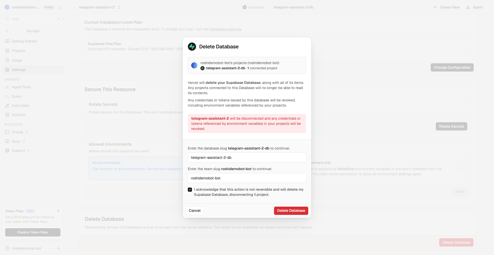

# איך מכבים הכול ומפסיקים לשלם

הבוט רץ בחשבונות שלך, ולכן גם הכיבוי אצלך. מספיק לעשות את שני הסעיפים הראשונים כדי שהבוט יפסיק לעבוד ושלא יהיו יותר חיובים. השאר הוא ניקיון.

## 1. מפסיקים את החיוב על ה-AI (חובה)
זה החיוב היחיד בערכה. ב-[API keys](https://platform.claude.com/settings/keys) של Claude Console מוחקים את המפתח של הבוט (`telegram-bot`). היתרה שטענת מראש נשארת בחשבון, ולא יורד ממנה יותר כסף.

> התקנת בעבר עם Gemini או עם ChatGPT? מוחקים את המפתח אצל אותו ספק. ב-Gemini גם סוגרים את חשבון החיוב ב-[Billing](https://console.cloud.google.com/billing), ‹ **Close billing account**.

## 2. מוחקים את הבוט בטלגרם
1. ב-[@BotFather](https://t.me/BotFather) שולחים `/deletebot`.
2. שולחים את שם המשתמש של הבוט, למשל `@dana_helper_bot`. (יש לך כמה בוטים? עדיף להקליד את השם מאשר לבחור מרשימה.)
3. BotFather כותב "you selected @...". בודקים שזה הבוט הנכון, ושולחים בדיוק `Yes, I am totally sure.`
4. מגיעה התשובה "Done! The bot is gone."

## 3. מוחקים את השרת (Vercel ו-Supabase)
1. ב-[vercel.com](https://vercel.com) נכנסים לפרויקט `telegram-assistant`.
2. **Storage** ‹ לוחצים על מסד הנתונים (שם בסגנון `supabase-apricot-garden`, או `telegram-assistant-db` אם התקנת עם Claude Code) ‹ **Settings** ‹ גוללים לתחתית ‹ **Delete Database**. בחלון מקלידים את שם המסד ואת שם החשבון שמופיעים שם, מסמנים **I acknowledge** ולוחצים **Delete Database**. זה מוחק את כל התזכורות, הפתקים והרשימות. 
3. **Settings** ‹ גוללים לתחתית ‹ **Delete Project**. בחלון מקלידים את שם הפרויקט ואת המשפט `delete my project`, ולוחצים **Delete Project**.

> יש לך כמה בוטים? בכל חלון מחיקה מופיע השם של מה שנמחק. בודקים שזה הבוט הנכון לפני שמקלידים.

> 💡 בחשבון החינמי של Supabase אפשר להחזיק שני בוטים פעילים לכל אדם. מחיקת מסד הנתונים מפנה מקום לבוט חדש.

## 4. מנתקים את Google (רק אם חיברת את התוספת)
1. ב-[הרשאות של חשבון Google](https://myaccount.google.com/permissions) לוחצים על "פרויקט ללא שם" ‹ **Remove access**.
2. ב-[Apps Script](https://script.google.com/home) לוחצים על שלוש הנקודות ליד "פרויקט ללא שם" ‹ **הסרה** (Remove).

## 5. מוחקים את מפתח הקול (רק אם חיברת את התוספת)
ב-[Groq](https://console.groq.com/keys) מוחקים את המפתח `telegram-bot`.

## 6. מוחקים את עותק הקוד (לא חובה)
1. ב-GitHub נכנסים לריפו `telegram-assistant` ‹ **Settings** ‹ גוללים לתחתית ‹ **Delete this repository**.
2. לוחצים **I want to delete this repository** ‹ **I have read and understand these effects**, ומקלידים את השם המלא שמופיע בחלון (למשל `dana/telegram-assistant`) ‹ **Delete this repository**.
3. GitHub מבקש לאשר שזה את/ה (**Confirm access**): לוחצים **Verify via email**, ומקלידים את הקוד שהגיע במייל.

## 7. התקנת עם Claude Code? עוד שני דברים
1. **הטוקנים** (אם לא מחקת אותם בסוף ההתקנה): ב-[GitHub](https://github.com/settings/tokens) מוחקים את `telegram-assistant-setup` ‹ **I understand, delete this token**. ב-[Vercel](https://vercel.com/account/settings/tokens) לוחצים על שלוש הנקודות ליד הטוקן שיצרת ‹ **Delete** ‹ **DELETE**. (שורות בשם "Vercel Dashboard from..." הן הכניסות שלך לאתר. לא נוגעים בהן.)
2. **התיקייה במחשב**: מוחקים את תיקיית `telegram-assistant` שבה Claude Code עבד.

---

את החשבונות עצמם (GitHub, Vercel, Google) אפשר להשאיר. הם חינמיים ולא מחייבים כלום.

